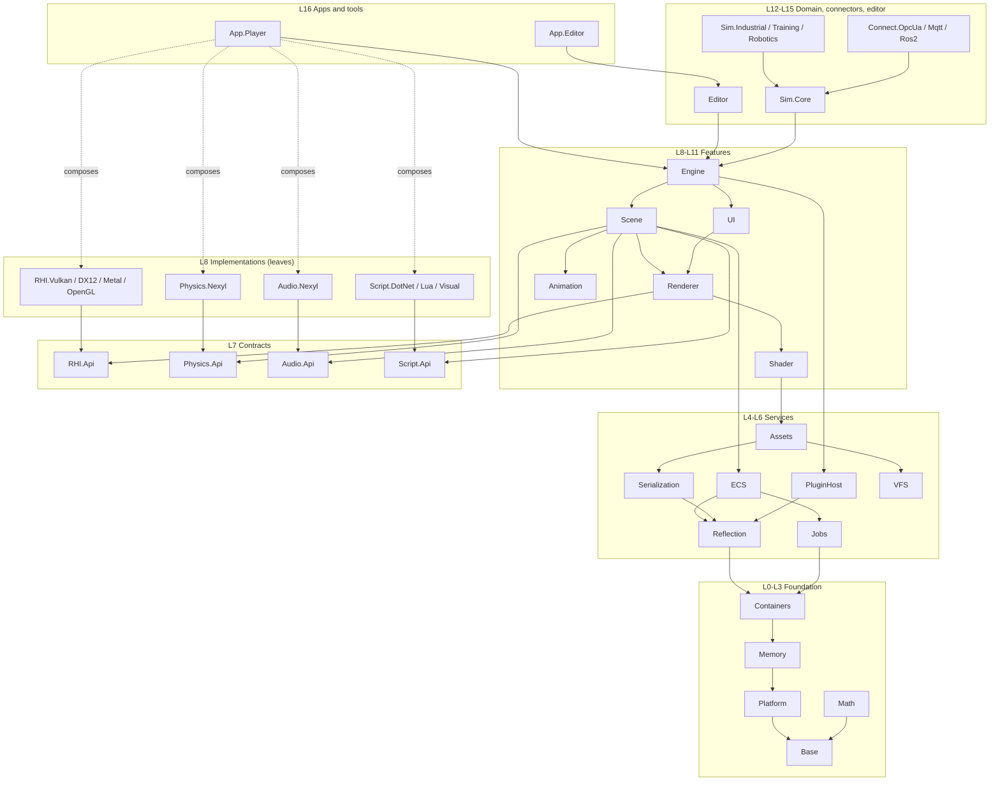
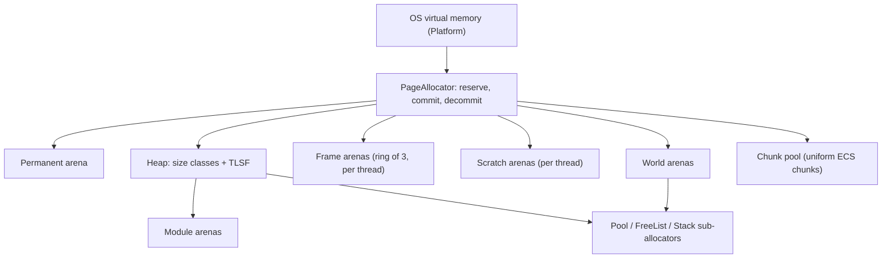
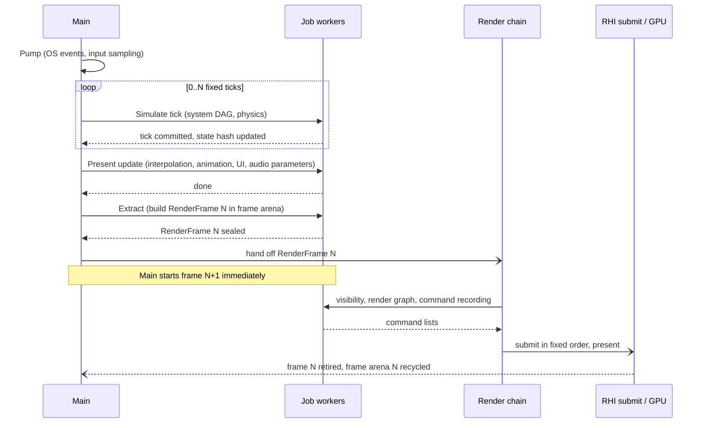
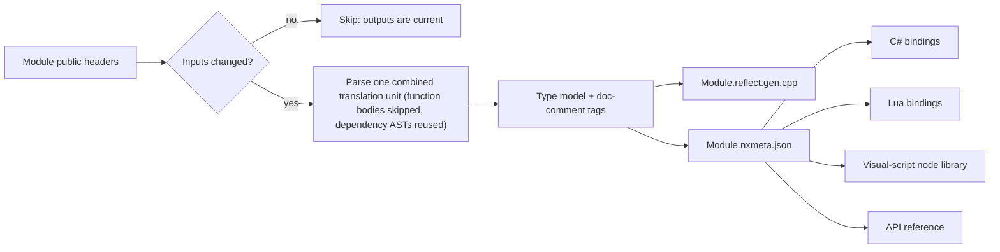
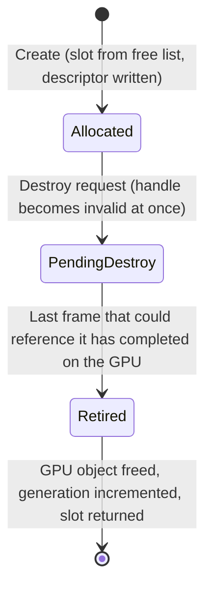

# Nexyl Engine — Architecture

| | |
|---|---|
| Status | Baseline 0.1 — foundation design, pre-implementation |
| Date | 2026-11-13 |
| Audience | Engine developers, plugin authors, technical leads |
| Companion documents | [CODING_STANDARDS.md](CODING_STANDARDS.md), [PLUGIN_ABI.md](PLUGIN_ABI.md), [../CLAUDE.md](../CLAUDE.md) |

The key words MUST, MUST NOT, SHOULD, SHOULD NOT and MAY are used as defined in RFC 2119.

## Contents

1. [Purpose and design invariants](#1-purpose-and-design-invariants)
2. [Platforms](#2-platforms)
3. [Repository layout and module anatomy](#3-repository-layout-and-module-anatomy)
4. [Module dependency graph](#4-module-dependency-graph)
5. [Memory architecture](#5-memory-architecture)
6. [Frame, simulation and threading model](#6-frame-simulation-and-threading-model)
7. [Determinism specification](#7-determinism-specification)
8. [Reflection, serialization, scripting and editor](#8-reflection-serialization-scripting-and-editor)
9. [RHI resource model and shader pipeline](#9-rhi-resource-model-and-shader-pipeline)
10. [Edge-case catalogue](#10-edge-case-catalogue)
11. [Risks](#11-risks)
12. [Roadmap](#12-roadmap)
13. [Decision log](#13-decision-log)

---

## 1. Purpose and design invariants

Nexyl is a modular, real-time 2D/3D engine written in C++23 that serves two equal-rank product lines from one codebase:

- **Game engine** — the first shippable milestone.
- **Simulation engine** — industrial digital twins, training and assessment simulators, robotics and autonomous-system test environments. These build on the same runtime and add domain modules.

The whole design follows from eleven invariants. Every later section elaborates one or more of them.

| # | Invariant |
|---|---|
| I-1 | Modules form a strict layered DAG. A module depends only on modules in strictly lower layers. |
| I-2 | The runtime is self-owned. Third-party code is allowed only in build-time tools, isolated adapter plugins and editor importers. |
| I-3 | The runtime is STL-free, except a fixed whitelist of compiler-support headers. |
| I-4 | No exceptions, no RTTI. Recoverable errors travel as `Result<T, Error>`. |
| I-5 | Every allocation has an explicit allocator, a tag and a lifetime class. |
| I-6 | The simulation is bit-exact across all supported platforms, compilers and worker counts. |
| I-7 | Simulation never depends on rendering. Rendering reads immutable snapshots. |
| I-8 | Every major subsystem (physics, audio, RHI, scripting) sits behind a contract module, so a third-party implementation can replace the first-party one. |
| I-9 | Reflection is automatic and annotation-free. Engine and user headers are plain C++. |
| I-10 | Plugins load identically whether linked dynamically or statically. |
| I-11 | Conventions are fixed: right-handed, Z-up, SI units; f64 world positions, f32 dynamics. |

### 1.1 Conventions

| Topic | Convention |
|---|---|
| Handedness and axes | Right-handed. X forward, Y left, Z up (matches ROS 2 REP-103). |
| Units | SI only: metre, kilogram, second, radian, newton. No centimetres, no degrees in APIs. |
| Rotation | Unit quaternions (f32). Positive rotation is counter-clockwise looking down the axis toward the origin. |
| World position | `Vec3d` (f64). All other spatial quantities (rotation, velocity, shape geometry, local offsets) are f32. |
| Rendering space | Camera-relative f32, derived from f64 at extraction. |
| Simulation time | `SimTime`: signed 64-bit count of 1/705 600 000 s. This unit divides evenly by every common tick rate (24, 25, 30, 50, 60, 90, 100, 120, 240, 1000 Hz) and audio rate (44.1 kHz, 48 kHz). |
| Byte order | Little-endian on all targets, asserted at startup. File formats are little-endian. |
| Text | UTF-8 everywhere. |

Asset importers convert foreign conventions (glTF: Y-up; FBX: configurable; Unreal content: left-handed centimetres) at import time. No runtime module performs axis or unit conversion.

---

## 2. Platforms

| Target | Architecture | RHI backend | Plugin linking | C# execution | Development host |
|---|---|---|---|---|---|
| Windows | x64 | DX12, Vulkan, OpenGL (compat) | Dynamic | CoreCLR (JIT) | Yes |
| Linux | x64 | Vulkan, OpenGL (compat) | Dynamic | CoreCLR (JIT) | Yes |
| macOS | ARM64 | Metal 3 | Dynamic | CoreCLR (JIT) | Yes |
| Android | ARM64 | Vulkan 1.3, OpenGL ES 3.2 (compat) | Dynamic | Ahead-of-time | No |
| iOS | ARM64 | Metal 3 | Static | Ahead-of-time (no JIT allowed) | No |
| PlayStation 5 | x64 | Platform-native (private overlay) | Static | Ahead-of-time (no JIT allowed) | No |
| Xbox Series | x64 | DX12 (GDK, private overlay) | Static | Ahead-of-time (no JIT allowed) | No |

Baseline: 64-bit only. x86-64-v2 and ARMv8.0-A with NEON are the minimum instruction sets.

Console SDKs are under NDA. The public repository contains only the abstract interfaces in `Platform` and `RHI.Api`. Console backends live in private overlay repositories mounted under `Platforms/` and add implementation modules without changing any public header. Outside `Platform`, the RHI backends and adapter modules, source code MUST NOT contain platform `#if` blocks; it queries capabilities instead.

---

## 3. Repository layout and module anatomy

```
nexyl/
├─ CLAUDE.md                       AI-assistant guide
├─ docs/                           Architecture, standards, ABI
├─ cmake/                          Build system: module system, compiler settings, conformance probes, gates
├─ Scripts/ci/                     CI gate scripts, independent of any CI provider
├─ Abi/include/nexyl/              C ABI headers (the Tier 2 plugin SDK)
├─ Source/
│  ├─ Runtime/<Module>/            Foundation, Service, Contract, Feature, Domain and TestLib modules
│  ├─ Plugins/<Module>/            Impl and Adapter modules
│  ├─ Editor/<Module>/             Editor modules
│  ├─ Tools/<Module>/              ToolLib and Tool modules (NHT, nxslc, nxcook)
│  ├─ Apps/<Module>/               App modules
│  └─ ThirdParty/<Name>/           Referenced only by Adapter and Tool modules
├─ Platforms/<Platform>/           Private overlays (PS5, Xbox), separate repositories
└─ Tests/                          Cross-module suites: build system, determinism, ABI, soak
```

A module's directory name is its module name, and its parent directory is fixed by its kind: `Physics.Api` lives in `Source/Runtime/Physics.Api/`, `RHI.Vulkan` in `Source/Plugins/RHI.Vulkan/`. The build discovers modules by that layout; there is no central list to edit.

Each module has the same internal shape:

```
<Module>/
├─ CMakeLists.txt                  One nexyl_add_module() call: the module manifest
├─ Public/Nexyl/<Module>/          The only headers other modules may include
├─ Private/                        Implementation; invisible to other modules
└─ Tests/                          Unit tests for this module
```

A logical module name maps mechanically to every other name:

| Logical name | CMake target | Namespace | Include root | Export macro |
|---|---|---|---|---|
| `Memory` | `Nexyl.Memory` | `Nexyl::Memory` | `<Nexyl/Memory/...>` | `NX_MEMORY_API` |
| `Physics.Api` | `Nexyl.Physics.Api` | `Nexyl::Physics` | `<Nexyl/Physics/...>` | `NX_PHYSICS_API` |
| `RHI.Vulkan` | `Nexyl.RHI.Vulkan` | `Nexyl::RHI::Vulkan` | (no public headers) | (none) |

The module manifest declares everything the build system enforces:

```cmake
nexyl_add_module(
    NAME      Physics.Api
    KIND      Contract
    LAYER     7
    DEPENDS   Base Math Memory Containers Jobs
    REFLECT   Public        # reflection scope, see section 8.3
    SIM_SAFE  ON)           # determinism lint, see section 7
```

The manifest contains this one call and nothing else. Compiler flags, export macros, include paths and test targets all come from the build system, so a module cannot diverge from the engine-wide configuration.

---

## 4. Module dependency graph

### 4.1 Rules

| Rule | Statement |
|---|---|
| R1 | A module MUST depend only on modules whose layer number is strictly lower. Same-layer dependencies are forbidden. |
| R2 | `Impl` and `Adapter` modules are leaves. Only `App` and `Tool` modules, and the module's own `*.Editor` companion, MAY depend on them. Everything else reaches them through a `Contract` interface at run time. |
| R3 | `Contract` modules contain only interfaces, handles and plain-data descriptors. No behaviour, no global state. |
| R4 | `ToolLib` modules are never linked into a shipping runtime. Only `ToolLib`, `Editor`, `Tool` and `App` modules MAY depend on them. |
| R5 | Only `Editor`, `Tool` and `App` modules MAY depend on an `Editor` module. |
| R6 | Only test targets MAY depend on a `TestLib` module. |
| R7 | Third-party code MAY be linked only by `Adapter` and `Tool` modules (an asset importer is an `Adapter` module), and MUST NOT appear in any public header. |

Rule R1 alone makes the graph acyclic. Rules R2–R7 keep the replaceable and non-shipping parts at the edge.

### 4.2 Module table (normative)

Dependencies listed are direct dependencies. This table is the source of truth; the diagram in 4.3 is a simplification.

| Module | Layer | Kind | Direct dependencies |
|---|---|---|---|
| `Base` | 0 | Foundation | — |
| `Platform` | 1 | Foundation | `Base` |
| `Memory` | 2 | Foundation | `Base`, `Platform` |
| `Math` | 2 | Foundation | `Base` |
| `Containers` | 3 | Foundation | `Base`, `Memory` |
| `Log` | 4 | Service | `Base`, `Platform`, `Memory`, `Containers` |
| `Profile` | 4 | Service | `Base`, `Platform`, `Memory`, `Containers` |
| `Test` | 4 | TestLib | `Base`, `Platform`, `Memory`, `Containers` |
| `Jobs` | 4 | Service | `Base`, `Platform`, `Memory`, `Containers` |
| `Reflection` | 4 | Service | `Base`, `Memory`, `Math`, `Containers` |
| `Serialization` | 5 | Service | `Base`, `Memory`, `Containers`, `Reflection` |
| `VFS` | 5 | Service | `Base`, `Platform`, `Memory`, `Containers`, `Jobs` |
| `Input` | 5 | Service | `Base`, `Platform`, `Memory`, `Math`, `Containers` |
| `PluginHost` | 5 | Service | `Base`, `Platform`, `Memory`, `Containers`, `Jobs`, `Reflection` |
| `ECS` | 6 | Service | `Base`, `Memory`, `Containers`, `Jobs`, `Reflection` |
| `Assets` | 6 | Service | `Base`, `Memory`, `Containers`, `Jobs`, `Reflection`, `Serialization`, `VFS` |
| `Net` | 6 | Service | `Base`, `Platform`, `Memory`, `Containers`, `Jobs`, `Serialization` |
| `ShaderCompiler` | 6 | ToolLib | `Base`, `Memory`, `Containers`, `VFS` |
| `RHI.Api` | 7 | Contract | `Base`, `Math`, `Memory`, `Containers` |
| `Physics.Api` | 7 | Contract | `Base`, `Math`, `Memory`, `Containers`, `Jobs` |
| `Audio.Api` | 7 | Contract | `Base`, `Math`, `Memory`, `Containers` |
| `Script.Api` | 7 | Contract | `Base`, `Memory`, `Containers`, `Reflection` |
| `AssetPipeline` | 7 | ToolLib | `Base`, `Memory`, `Containers`, `Jobs`, `Reflection`, `Serialization`, `VFS`, `Assets`, `ShaderCompiler` |
| `Shader` | 8 | Feature | `Base`, `Memory`, `Containers`, `Serialization`, `Assets`, `RHI.Api` |
| `RHI.Vulkan` | 8 | Impl | `Base`, `Platform`, `Memory`, `Containers`, `Jobs`, `RHI.Api` |
| `RHI.DX12` | 8 | Impl | `Base`, `Platform`, `Memory`, `Containers`, `Jobs`, `RHI.Api` |
| `RHI.Metal` | 8 | Impl | `Base`, `Platform`, `Memory`, `Containers`, `Jobs`, `RHI.Api` |
| `RHI.OpenGL` | 8 | Impl | `Base`, `Platform`, `Memory`, `Containers`, `Jobs`, `RHI.Api` |
| `Physics.Nexyl` | 8 | Impl | `Base`, `Math`, `Memory`, `Containers`, `Jobs`, `Physics.Api` |
| `Audio.Nexyl` | 8 | Impl | `Base`, `Platform`, `Math`, `Memory`, `Containers`, `Jobs`, `Audio.Api` |
| `Script.DotNet` | 8 | Adapter | `Base`, `Platform`, `Memory`, `Containers`, `Reflection`, `Script.Api` |
| `Script.Lua` | 8 | Adapter | `Base`, `Memory`, `Containers`, `Reflection`, `Script.Api` |
| `Script.Visual` | 8 | Impl | `Base`, `Memory`, `Containers`, `Reflection`, `Serialization`, `Assets`, `Script.Api` |
| `Renderer` | 9 | Feature | `Base`, `Math`, `Memory`, `Containers`, `Jobs`, `Assets`, `RHI.Api`, `Shader` |
| `Animation` | 9 | Feature | `Base`, `Math`, `Memory`, `Containers`, `Jobs`, `Reflection`, `Assets` |
| `Scene` | 10 | Feature | `Base`, `Math`, `Memory`, `Containers`, `Jobs`, `Reflection`, `Serialization`, `ECS`, `Assets`, `Physics.Api`, `Audio.Api`, `Script.Api`, `Renderer`, `Animation` |
| `UI` | 10 | Feature | `Base`, `Math`, `Memory`, `Containers`, `Jobs`, `Reflection`, `Input`, `Assets`, `Renderer` |
| `Engine` | 11 | Feature | `Base`, `Platform`, `Memory`, `Containers`, `Log`, `Profile`, `Jobs`, `Reflection`, `Serialization`, `VFS`, `Input`, `PluginHost`, `ECS`, `Assets`, `Net`, `RHI.Api`, `Physics.Api`, `Audio.Api`, `Script.Api`, `Renderer`, `Scene`, `UI` |
| `Editor` | 12 | Editor | `Base`, `Memory`, `Containers`, `Reflection`, `Serialization`, `VFS`, `Assets`, `ShaderCompiler`, `AssetPipeline`, `Scene`, `UI`, `Engine` |
| `Sim.Core` | 12 | Domain | `Base`, `Math`, `Memory`, `Containers`, `Jobs`, `Reflection`, `Serialization`, `ECS`, `Scene`, `Engine` |
| `Sim.Industrial` | 13 | Domain | `Base`, `Math`, `Memory`, `Containers`, `Reflection`, `ECS`, `Scene`, `Engine`, `Sim.Core` |
| `Sim.Training` | 13 | Domain | `Base`, `Memory`, `Containers`, `Reflection`, `Serialization`, `ECS`, `Scene`, `UI`, `Engine`, `Sim.Core` |
| `Sim.Robotics` | 13 | Domain | `Base`, `Math`, `Memory`, `Containers`, `Reflection`, `ECS`, `Physics.Api`, `Scene`, `Engine`, `Sim.Core` |
| `Connect.OpcUa` | 14 | Adapter | `Base`, `Memory`, `Containers`, `Sim.Core` |
| `Connect.Mqtt` | 14 | Adapter | `Base`, `Memory`, `Containers`, `Sim.Core` |
| `Connect.Ros2` | 14 | Adapter | `Base`, `Math`, `Memory`, `Containers`, `Sim.Core`, `Sim.Robotics` |
| `Script.Visual.Editor` | 15 | Editor | `Base`, `Containers`, `Reflection`, `UI`, `Editor`, `Script.Visual` |
| `Sim.Industrial.Editor` | 15 | Editor | `Base`, `Containers`, `Reflection`, `UI`, `Editor`, `Sim.Industrial` |
| `Sim.Training.Editor` | 15 | Editor | `Base`, `Containers`, `Reflection`, `UI`, `Editor`, `Sim.Training` |
| `Sim.Robotics.Editor` | 15 | Editor | `Base`, `Containers`, `Reflection`, `UI`, `Editor`, `Sim.Robotics` |
| `Tools.NHT` | 16 | Tool | — |
| `Tools.Nxslc` | 16 | Tool | `Base`, `Platform`, `Memory`, `Containers`, `VFS`, `ShaderCompiler` |
| `Tools.Cook` | 16 | Tool | `Base`, `Platform`, `Memory`, `Containers`, `Log`, `Jobs`, `VFS`, `Assets`, `AssetPipeline` |
| `App.Player` | 16 | App | `Engine`, `RHI.Vulkan`, `RHI.DX12`, `RHI.Metal`, `RHI.OpenGL`, `Physics.Nexyl`, `Audio.Nexyl`, `Script.DotNet`, `Script.Lua`, `Script.Visual` |
| `App.Editor` | 16 | App | `Engine`, `Editor`, `RHI.Vulkan`, `RHI.DX12`, `RHI.Metal`, `Physics.Nexyl`, `Audio.Nexyl`, `Script.DotNet`, `Script.Lua`, `Script.Visual`, `Script.Visual.Editor` |

Module responsibilities in one line each:

| Module | Responsibility |
|---|---|
| `Base` | Compiler and platform detection, primitive type aliases, assert/log/profile hooks, `Result`, `Option`, `Span`, the only include site of whitelisted standard headers. Allocates nothing, calls no OS function. |
| `Platform` | Hardware abstraction: virtual memory, threads, synchronisation, files, time, dynamic libraries, sockets, windows, raw input. Its API never allocates; callers supply buffers. |
| `Memory` | Allocators, tags, budgets, tracking. |
| `Math` | Deterministic scalar, vector, matrix and quaternion math, transcendental functions, SIMD abstraction. |
| `Containers` | `Array`, `HashMap`, `String`, `StringView`, smart pointers, handles, handle pools. |
| `Jobs` | Work-stealing job scheduler, deterministic parallel-for, job handles. |
| `Reflection` | Runtime type registry and type-info model; also hosts the generated tables for layer 0–3 types. |
| `Serialization` | Reflection-driven binary and text archives, schema versioning, migration. |
| `VFS` | Virtual file system, mount points, asynchronous I/O. |
| `Input` | Device abstraction and action mapping on top of raw platform input. |
| `PluginHost` | Module discovery, loading, lifecycle, interface registry, hot reload. See [PLUGIN_ABI.md](PLUGIN_ABI.md). |
| `ECS` | Archetype-chunk entity storage, queries, system scheduler, command buffers. |
| `Assets` | Asset identity, loading, streaming, dependency tracking, reference counting. |
| `Net` | Transport and message primitives. No knowledge of entities. |
| `ShaderCompiler` | NXSL front end, intermediate representation, back ends. |
| `*.Api` | Subsystem contracts. See [PLUGIN_ABI.md](PLUGIN_ABI.md). |
| `Shader` | Runtime shader library: loads compiled shader binaries and permutations. |
| `Renderer` | Render graph, GPU scene, materials, visibility. Consumes `RenderFrame` packets; knows nothing about entities. |
| `Animation` | Skeletons, clips, blending and evaluation as a pure library. |
| `Scene` | Transform hierarchy, prefabs, levels, and the bridge systems that connect `ECS` to renderer, physics, audio and scripts. |
| `UI` | Nexyl's own UI framework, used by both games and the editor. |
| `Engine` | Frame loop, world management, subsystem resolution, time. |
| `Sim.Core` | Discrete-event kernel, scenarios, recording and replay, KPI collection, external signal bus. |
| `Sim.Industrial` | Machines, conveyors, material flow, failure and maintenance models. |
| `Sim.Training` | Training and assessment: tasks, scoring, progress, instructor reports. |
| `Sim.Robotics` | Articulated robots, sensor models, path and task execution. |
| `Connect.*` | Bridges to OPC UA, MQTT and ROS 2. |

### 4.3 Diagram (simplified)

An arrow reads "depends on". Transitive edges and most foundation edges are omitted.



### 4.4 How the classic cycles are broken

| Would-be cycle | Resolution |
|---|---|
| Assert and logging need strings and I/O; strings and I/O need asserts | `Base` owns three function-pointer hooks (assert handler, log sink, profile sink). Higher modules install real implementations at startup. Any module can assert, log and profile while depending only on `Base`. |
| Allocators need OS memory; OS wrappers want to allocate | `Platform` never allocates. Its functions take caller-supplied buffers and spans. |
| Reflection needs containers; containers want to be reflected | `Reflection` sits above `Containers`. The generated reflection tables for layer 0–3 types are compiled into `Reflection` itself. |
| Renderer wants entities; ECS wants to draw | Neither knows the other. `Scene` extracts render data from `ECS` into a `RenderFrame` packet that `Renderer` defines. |
| Physics wants entities; ECS wants to simulate | `Physics.Api` speaks only in handles and batches. `Scene` owns the handle-to-entity mapping. The same pattern applies to audio and scripts. |
| Engine must find implementations; implementations must not be dependencies | Implementations register interfaces with the `PluginHost` interface registry at load time. `Engine` resolves contracts by interface ID. Only the `App` (the composition root) names concrete modules. |
| Runtime needs editor-only data | It does not. Editor-only state lives in `Editor` modules. Editor-only reflection metadata is stripped from shipping builds. |
| Runtime shaders need the compiler | Shipping runtimes load precompiled binaries through `Shader`. `ShaderCompiler` is a `ToolLib`, reachable only from tools and the editor. |

### 4.5 Enforcement

| Mechanism | What it catches |
|---|---|
| Module graph validation at configure time (`cmake/NexylModule.cmake`) | R1, R2 and R4–R6 on the declared graph; R3 structurally (a `Contract` module has no source files); R7 (only `Adapter` and `Tool` modules may name third-party targets); module location and naming. A violation fails CMake configuration. |
| `gate.sources` (include scanner) | An `#include <Nexyl/X/...>` whose module is not a declared dependency; any include of another module's `Private/` path; standard, system or third-party headers outside the places that allow them. |
| `gate.manifests` | A manifest that contains anything besides its one `nexyl_add_module()` call; files outside the fixed module shape. |
| `gate.module_table` | Drift between the table in 4.2 and the manifests; a documented table that itself breaks R1, R2, R4, R5 or R6. |
| `gate.headers` | A public header that does not compile on its own. |
| Hidden symbol visibility plus per-module export macro | Accidental use of non-exported symbols fails at link time. |

The gates are CTest tests, so `ctest --preset <preset>` runs the same checks locally and in CI. Both the graph rules and the gate scripts have their own tests with deliberately invalid inputs.

---

## 5. Memory architecture

### 5.1 Principles

1. **No hidden allocation.** Every allocation names its allocator. Engine code MUST NOT call global `new`, `delete`, `malloc` or `free`.
2. **Lifetime first.** Memory is grouped by when it dies, not by what it is. Bulk release of an arena replaces thousands of individual frees.
3. **Sized deallocation.** The caller passes the size back on free, so allocators need no per-block header.
4. **Uniform container types.** Containers store an `IAllocator*` rather than taking an allocator template parameter. `Array<T>` is one type everywhere, which keeps reflection, serialization and the Tier 1 ABI simple.
5. **Budgets are contracts.** Each tag has a budget per platform. Exceeding it is a reportable event in development and a hard failure in certification builds.

### 5.2 Hierarchy



### 5.3 Allocator contract

Every allocator implements `IAllocator`. The contract, not the signature, is specified here.

| Operation | Contract |
|---|---|
| Allocate (size, alignment) | Returns a block or terminates through the out-of-memory handler. Never returns null. |
| TryAllocate (size, alignment) | Returns a block or an `Error`. For large or optional allocations where the caller can degrade. |
| Deallocate (pointer, size) | Size MUST equal the allocated size. Arena-style allocators treat this as a no-op. |
| Reallocate (pointer, old size, new size, alignment) | May grow in place. Contents are preserved up to the smaller size. |
| Owns (pointer) | Debug-only membership test. |
| Statistics | Bytes in use, peak, allocation count, and for free-list allocators a fragmentation index. |

Thread safety is a property of the concrete allocator and is part of its documentation.

### 5.4 Allocator catalogue

| Allocator | Strategy | Individual free | Thread safety | External fragmentation | Typical use |
|---|---|---|---|---|---|
| `PageAllocator` | Reserve address space, commit on demand, decommit on release | Whole ranges | Safe | None (page granularity) | Root of everything |
| `LinearAllocator` | Bump pointer in a fixed block | No, reset only | Single thread | None | Frame data, parse buffers |
| `StackAllocator` | Bump pointer with markers, LIFO release | LIFO only | Single thread | None | Nested temporary scopes |
| `ArenaAllocator` | Bump pointer over a growing chain of blocks, or over one reserved range that commits forward | No, reset or destroy | Single thread (one per owner) | None | Level, asset-load and per-job lifetimes |
| `PoolAllocator` | Fixed-size blocks with an intrusive free list | Yes, O(1) | Variant per need | None | Uniform objects: nodes, handles, ECS chunks |
| `FreeListAllocator` | TLSF (two-level segregated fit), immediate coalescing | Yes, O(1) | Externally locked | Bounded, measurable | Variable-size blocks inside a fixed budget, GPU memory |
| `Heap` | Size classes with per-thread caches for small blocks, TLSF for medium, direct pages for large | Yes | Safe | Low | General-purpose last resort |
| `TrackingAllocator` | Proxy: records call sites and tags | Pass-through | As inner | — | Leak and budget diagnostics |
| `GuardAllocator` | Proxy: one allocation per page range with guard pages | Pass-through | Safe | — | Overrun and use-after-free hunting |

`FreeListAllocator` is the "free list" allocator of the requirements; TLSF is the chosen policy because it gives constant-time operations and a predictable fragmentation bound, both required for real-time and long-running simulation use.

### 5.5 Lifetime classes

| Class | Backing | Born | Dies | Rules |
|---|---|---|---|---|
| Permanent | `ArenaAllocator` | Engine startup | Engine shutdown | Never freed individually. Only for data that truly lives for the whole process. |
| Module | `ArenaAllocator` on `Heap` | Module load | Module unload | Must be empty of live objects at unload. A non-empty module arena at hot reload is a reported leak. |
| World | `ArenaAllocator` plus sub-allocators | World or level load | World or level unload | Released in bulk. Nothing outside the world may hold pointers into it; use handles. |
| Frame | `LinearAllocator` per thread, ring of 3 | Start of frame N | When the GPU has retired frame N | Data may be read by the render chain for frame N. Never stored beyond it. |
| Scratch | `StackAllocator` per thread | Scope entry | Scope exit | A scratch scope MUST NOT cross a job boundary or a wait. |
| SimTick | `LinearAllocator` per thread | Start of a simulation tick | End of that tick | For transient solver and query data. Contents never enter simulation state. |
| Persistent | `Heap`, tagged | Any time | Explicit | The fallback. Every use needs a tag; untagged persistent allocation is a CI failure in runtime modules. |

The frame ring has three slots because, at the moment the simulation writes frame N, the render chain may still be reading N−1 and the GPU may still be consuming N−2.

### 5.6 Ownership across module boundaries

- Memory is freed by the allocator that produced it. Across a module boundary this is guaranteed by passing the allocator, a handle, or an intrusively reference-counted object — never a raw owning pointer.
- A dynamically loaded module MUST NOT own a private heap. It receives its allocators from the host at load time (see [PLUGIN_ABI.md](PLUGIN_ABI.md)).
- Executables replace the global `operator new` and `operator delete` only to route third-party code inside adapter modules into a tracked `ThirdParty` tag. Engine code reaching those operators is flagged by a lint.

### 5.7 Fragmentation control

Fragmentation is controlled by structure first and by measurement second.

| Technique | Effect |
|---|---|
| Lifetime arenas instead of individual frees | Most memory never enters a free list at all. |
| Uniform ECS chunks from one `PoolAllocator` | All entity storage has zero external fragmentation, regardless of archetype churn. |
| Size-class segregation in `Heap` | Small blocks of different sizes never interleave. |
| Reserve-then-commit growth | Large arrays grow in place inside a reserved address range; no reallocate-and-copy, no abandoned holes. |
| Direct page allocation for large blocks | Large blocks return to the OS immediately and cannot pin a heap region. |
| Handle indirection | Assets and GPU resources are referenced by handle, so their backing memory can be moved. This enables defragmentation of asset and GPU heaps during idle frames. |
| Decommit of empty spans | Long-running sessions return physical memory without giving up address space. |

Measurement: each `FreeListAllocator` and `Heap` region exposes a fragmentation index, defined as one minus the ratio of the largest free block to total free bytes. A soak test loads and unloads a representative level set for a fixed number of cycles and fails if the index or the committed size trends upward.

### 5.8 Budgets and out-of-memory policy

- Each allocation carries a tag (for example `Physics`, `RenderScene`, `Audio`, `Script`, `ThirdParty`). Tags roll up to per-platform budgets defined in platform configuration.
- Small allocations use `Allocate`. Failure invokes the out-of-memory handler, which writes a tagged memory report and terminates. Continuing after a failed small allocation is not attempted.
- Large or optional allocations (asset payloads, streaming tiles, caches) use `TryAllocate` and return an `Error`, so the caller can evict, lower quality or refuse the request.
- Mobile targets react to OS memory-pressure notifications by trimming caches before the OS terminates the process.

### 5.9 Startup, shutdown and static initialization

- There are no non-trivial static constructors or destructors anywhere in the runtime. Global state is `constinit` or created explicitly.
- Startup order is explicit and fixed: `Platform` → `Memory` (page allocator, permanent arena, heap) → `Log` and `Profile` hooks → `Jobs` → `Reflection` registry → `PluginHost` → modules in dependency order.
- Shutdown is the exact reverse. Each lifetime boundary verifies that its arena has no live tracked objects.

### 5.10 Platform constraints

| Platform | Constraint | Design response |
|---|---|---|
| iOS | Virtual address space is restricted on some devices. | Reservation sizes are platform configuration, not constants. No code may assume multi-gigabyte reservations. |
| Consoles | Fixed physical budget, no overcommit, certification limits. | Budgets are hard. All arenas are sized from platform configuration at startup. |
| Android | The OS kills background processes under pressure. | Trim callbacks release caches; the heap decommits aggressively. |
| Desktop | Large pages available but optional. | `PageAllocator` requests large pages for the chunk pool when permitted and falls back silently. |

### 5.11 Interaction with determinism

Addresses differ from run to run and platform to platform, so they MUST NOT influence simulation results. Concretely: simulation code never orders, hashes or branches on pointer values; simulation state never contains raw pointers; and state hashing visits fields individually so padding bytes are never read.

---

## 6. Frame, simulation and threading model

### 6.1 Thread roles

| Thread | Count | Role | May block |
|---|---|---|---|
| Main | 1 | Platform message pump, frame orchestration, system scheduling. Helps run jobs while waiting. | Only on job completion (by helping) |
| Job workers | Hardware threads minus reserved | Run all parallel simulation, extraction and render work. | Never on I/O or locks held across jobs |
| Render chain | Logical | A chain of jobs that turns one `RenderFrame` into command lists. Not a dedicated OS thread. | No |
| RHI submit | 1 | Owns submission and presentation. Required because some APIs bind a context to one thread. | On GPU back-pressure |
| I/O | Small pool | Blocking file and network calls. | Yes |
| Audio mixer | 1, real-time priority | Runs the mix callback. Communicates only through lock-free queues. | Never |
| Connector | One per external link | OPC UA, MQTT, ROS 2 network traffic. | Yes |

The worker count is fixed at startup. No code may query the worker count to decide how to partition simulation work (see 7.6).

### 6.2 Job system

- Work-stealing deques, one per worker. A job is a function pointer plus a small inline payload; larger payloads live in frame or tick memory.
- Waiting on a job handle executes other jobs. There are no fibers in the first version: stack-based helping is portable to every target SDK and debugger.
- Four priorities: `High` (frame-critical), `Normal`, `Low`, `Background` (asset processing).
- Jobs MUST NOT perform blocking system calls or hold a lock across a wait.
- `ParallelFor` takes an item count and a **grain size chosen by the call site**. The number and boundaries of batches depend only on those two values.

### 6.3 Frame pipeline



| Phase | Owner | Step type | Deterministic | Purpose |
|---|---|---|---|---|
| Pump | Main | Variable | No | Collect OS events. Convert input into commands stamped with the tick they apply to. |
| Simulate | Main + workers | Fixed, 0..N per frame | **Yes** | Advance simulation state. |
| Present | Main + workers | Variable | No | Visual-only work: interpolation between the last two simulation states, cosmetic animation, UI, camera, audio parameters. Reads simulation state, never writes it. |
| Extract | Main + workers | Variable | No | Copy everything rendering needs into an immutable `RenderFrame`. The only synchronisation point between simulation and rendering. |
| Render | Render chain | Variable | No | Culling, render graph compilation, parallel command recording. |
| Submit | RHI submit | Variable | No | Queue submission and presentation. |

### 6.4 Fixed-step loop

- Simulation advances in fixed ticks of duration `SimTime` units per tick, derived from the configured tick rate (default 60 Hz; 240–1000 Hz for robotics control loops).
- In real-time mode an accumulator decides how many ticks run this frame. The count is clamped. When the clamp is hit, simulation time falls behind wall time; the step size never changes.
- The solver's `dt` is a single f32 constant computed once from the tick rate.

### 6.5 Anatomy of a tick

| Stage | Content | Structural changes applied after |
|---|---|---|
| `InputApply` | Apply this tick's command stream: player input, external signals, scenario events. | Yes |
| `PrePhysics` | Gameplay and control systems; write forces, targets and kinematic poses. | Yes |
| `Physics` | `Scene` pushes changes to the physics world, steps it once, pulls results. | Yes |
| `PostPhysics` | Systems that react to motion and contacts; sensors; domain logic. | Yes |
| `Commit` | Advance tick counter, update the state hash, append to the replay log, seal the state for interpolation. | — |

Entity creation, destruction and component add/remove are never performed in place. Systems write them to command buffers, which are applied at stage boundaries in a fixed order (see 7.6).

### 6.6 System scheduling

Each system declares its stage, the component types it reads and writes, the global resources it uses, and optional ordering constraints. From these declarations the scheduler compiles a static DAG, once per world configuration:

- Two systems may run in parallel only if neither writes what the other reads or writes.
- Within a stage, ties are broken by the systems' `TypeId`, so the compiled order is identical on every platform.
- A system that touches undeclared data fails an access check in development builds.

### 6.7 Extraction and render handoff

- `RenderFrame` is defined by `Renderer` and filled by `Scene`. It contains camera-relative f32 transforms (converted from f64 world positions), visibility inputs, light and material references by handle, and UI draw data.
- Interpolation between the last two committed simulation states happens during Present and Extract. The render chain never sees simulation state and never touches `ECS`.
- After sealing, a `RenderFrame` is immutable. Its memory is the frame arena of that frame.
- At most one sealed `RenderFrame` waits for the render chain. If rendering falls behind, Main helps run jobs instead of producing another frame.

### 6.8 Subsystem bridges

- **Physics.** Before the step, `Scene` sends new bodies, kinematic targets and forces in batches. After the step it reads back the poses of bodies that moved and the contact events, both in a deterministic order. No physics callback ever runs engine code from a worker thread.
- **Audio.** Simulation emits audio events deterministically; the audio system renders them non-deterministically. Parameters are flushed once per frame through a lock-free queue to the mixer thread.
- **Scripts.** Scripts attached to simulation stages run inside the deterministic schedule. Presentation scripts run in the Present phase.
- **External connectors.** Network threads place incoming values into a queue. Values enter the simulation only at `InputApply`, stamped with a tick and written to the replay log. Outgoing values are published after `Commit`.

### 6.9 Time modes

| Mode | Tick pacing | Use |
|---|---|---|
| Real-time | Accumulator against wall clock | Games, operator training, hardware-in-the-loop |
| Scaled | Real-time with a rational speed factor | Fast-forward and slow motion |
| As-fast-as-possible | Next tick starts immediately | Batch experiments, CI, headless digital-twin runs |
| Event-stepped | Jump to the next scheduled discrete event when no continuous dynamics are active | Pure process-flow simulation |
| Externally stepped | Advance exactly when an external master requests it | ROS 2 controllers using simulation time, co-simulation |

All modes produce identical simulation state for the same inputs, because pacing only decides when a tick runs, never what it computes. Headless operation is the same loop without Present, Extract, Render and Submit.

---

## 7. Determinism specification

### 7.1 Guarantee

Given the same engine build of the simulation-safe modules, the same content, the same initial state, the same simulation configuration and the same input log, the sequence of per-tick state hashes is bit-identical on every supported operating system, CPU architecture and compiler, with any worker count.

Not covered: rendered images, audio output, wall-clock timing, third-party physics adapters that do not declare the deterministic capability, and comparisons across different engine versions unless a release explicitly declares determinism compatibility.

### 7.2 Simulation-safe modules

The strict floating-point configuration of 7.3 applies to **every** module, not only to simulation-safe ones. The reason is the one-definition rule: an inline function used by two translation units compiled with different floating-point flags is merged by the linker into a single definition, so with per-module flags simulation code could silently call a copy compiled without the strict flags.

A module marked `SIM_SAFE ON` is additionally checked by the determinism lint. The set is: `Math`, `ECS` (scheduler and storage), `Physics.Api`, `Physics.Nexyl`, `Script.Visual`, `Scene` (simulation-stage systems), `Sim.Core`, `Sim.Industrial`, `Sim.Training`, `Sim.Robotics`. Gameplay modules opt in.

### 7.3 Floating-point environment

| Aspect | Requirement |
|---|---|
| Format | IEEE-754 binary32 and binary64 only. `long double` is banned. |
| Rounding | Round-to-nearest-even. Verified at the start of every tick on every simulation thread. |
| Subnormals | IEEE-compliant. Flush-to-zero and denormals-are-zero modes are **off** on simulation threads, because their corner-case behaviour differs between x86 and ARM. |
| Contraction | No fused multiply-add may be generated implicitly. `a * b + c` is always two rounded operations. |
| Fast-math | Forbidden in every form: no reassociation, no reciprocal substitution, no finite-math assumptions. |
| x87 | Not applicable; 64-bit only. |

Required compiler configuration, applied to all modules by `cmake/NexylCompiler.cmake`:

| Toolchain | Configuration |
|---|---|
| MSVC (`cl`) | `/fp:precise`, which does not contract; never `/fp:fast` or `/fp:contract`. |
| clang-cl | `/clang:-ffp-contract=off`. `/fp:precise` is **not** used: clang-cl maps it to a model that enables contraction. |
| Clang, Apple Clang, console Clang | `-ffp-contract=off -fno-fast-math` and no flag from the `-ffast-math` family. |
| GCC | `-ffp-contract=off -fno-fast-math -fexcess-precision=standard`. |

The determinism CI matrix (7.9), not this table, is the final authority: a toolchain is supported when it reproduces the reference hash chains.

### 7.4 Arithmetic rules

| Rule | Reason |
|---|---|
| Only `+ − × ÷` and square root may be used as primitive floating-point operations. | IEEE-754 requires these to be correctly rounded, so they agree on all hardware. |
| All other functions (trigonometric, exponential, logarithmic, power, cube root) come from `Nexyl::Math`, implemented with the primitives above in a fixed evaluation order. | Platform math libraries differ in the last bit. |
| Hardware reciprocal and reciprocal-square-root estimates are forbidden. | They differ between CPU vendors. |
| `Min`, `Max` and `Clamp` are defined by explicit comparison and select. | Hardware min/max instructions differ between x86 and ARM for NaN and signed zero. |
| Float-to-integer conversion goes through saturating helpers. | Out-of-range conversion is undefined and returns different values on x86 and ARM. |
| NaN and infinity MUST NOT appear in simulation state. | NaN payload propagation differs. Their presence at `Commit` is a fatal simulation error. |
| No expression may rely on the evaluation order of function arguments. | The order is unspecified and differs between compilers; two random draws as arguments of one call would diverge. |
| Plain `char`, `long` and `wchar_t` are banned in simulation state and arithmetic. | Their signedness or size differs between targets. |
| Signed integer overflow is avoided; wrapping arithmetic uses unsigned types or explicit helpers. | Overflow is undefined behaviour. |

### 7.5 Mixed precision

World positions are f64; dynamics are f32. Every narrowing from f64 to f32 MUST happen relative to a deterministic local origin (a body's centre of mass, an island origin, or the camera for rendering). Absolute world coordinates are never truncated to f32. Position integration has one defined form: the f32 displacement `velocity × dt` is computed and rounded in f32, widened exactly to f64, then added to the f64 position.

Numerically sensitive algorithms, such as long articulated chains, MAY use f64 internally. This is invisible at interfaces and does not create a second build configuration.

### 7.6 Ordering and scheduling rules

Job scheduling is non-deterministic by nature. Results are made independent of it:

| Concern | Rule |
|---|---|
| Parallel partitioning | Batch boundaries derive from item count and a call-site grain size, never from worker count or timing. |
| Parallel output | Each batch writes to its own buffer. Buffers are merged in batch-index order. |
| Reductions | Sums and other reductions combine per-batch results in a fixed tree order. No shared accumulators. |
| Structural changes | Command buffers are applied at stage boundaries, sorted by (system order, batch index, sequence within batch). |
| Entity identity | Entity IDs are allocated deterministically from that same order. |
| System order | From the compiled DAG with `TypeId` tie-breaking (6.6). |
| Physics | Broad-phase pairs are sorted before narrow phase. Islands are ordered by their lowest body ID and solved independently. Within an island, constraints are solved in sorted order; very large islands use a deterministic graph colouring so that same-colour constraints can run in parallel without affecting the result. |
| Events | Contact and trigger events are reported sorted by a stable key. |

### 7.7 Data structure rules

- `HashMap` uses a fixed hash seed and stores entries densely in insertion order, so iteration order is reproducible. Per-process hash randomisation is not used.
- Keys in simulation state are never pointers.
- Sorting in simulation code requires a total order (unique keys or a full tie-break).
- Simulation-state types have no uninitialised fields.

### 7.8 Randomness, time and other inputs

| Source | Rule |
|---|---|
| Random numbers | Counter-based generator keyed by (world seed, tick, stream ID, entity ID). No global or thread-local generator state. |
| Time | Simulation code sees only `SimTime`. Wall-clock access is a lint error in simulation-safe modules. |
| Thread identity | Never observable from simulation code. |
| External data | Enters only at `InputApply`, recorded in the input log (6.8). A live session is as deterministic as its recorded log; replay of that log is exact. |
| C# scripts | Simulation-stage code is restricted to a deterministic subset: engine math only, no platform math, no hash-order-dependent collections. Enforced by a source analyzer. |
| Lua scripts | Fixed hash seed; the standard math library is replaced by engine math; order-dependent traversal of non-sequence tables is rejected in simulation-stage scripts. |
| Visual scripts | Deterministic by construction: the virtual machine exposes only simulation-safe nodes in simulation graphs. |

### 7.9 Verification

- **State hash.** At every `Commit` a 64-bit hash is computed over all simulation-state fields, visiting entities in ID order and fields in declaration order through generated code. Fields tagged `@transient` or `@presentation` are excluded.
- **Replay file.** Initial snapshot, simulation configuration, input log, and the hash chain. A replay fails at the first tick whose hash differs, which localises a divergence to one tick.
- **Snapshots.** Any tick can be saved and restored exactly. This serves replay seeking, scenario reset and rollback networking.
- **CI determinism matrix.** A fixed scenario suite runs on every simulation-affecting change across: MSVC x64, Clang x64, GCC x64, Apple Clang ARM64, Android Clang ARM64; each with one worker and with many workers. All hash chains must be identical.
- **Divergence tooling.** On mismatch, the tool re-runs both sides with per-system hashing to name the first system and component that differ.

---

## 8. Reflection, serialization, scripting and editor

### 8.1 Goals

- **Annotation-free.** Types are plain C++. There are no marker macros, no generated-body macro, and user headers never include generated files.
- **Automatic.** A build tool discovers types from the real C++ syntax tree.
- **Fast at build time.** Reflection must not become the slow step of the build.
- **Fast at run time.** No start-up registration cost, no per-field interpretation on hot paths.
- **One source of truth** for serialization, script bindings, editor UI and API documentation.

### 8.2 Authoring model

This is a complete, reflected, serializable, editor-visible, script-accessible component. Nothing else needs to be written.

```cpp
/// A conveyor belt segment.
struct Conveyor {
    /// Belt speed.
    /// @units m/s
    /// @range 0..5
    f32 speed = 1.0f;

    /// Runtime cache, rebuilt on load.
    /// @transient
    u32 cachedItemCount = 0;

    AssetRef<Mesh> mesh;
    Vec3d origin;
};
```

### 8.3 Scope and eligibility

The module manifest sets the reflection scope (`REFLECT` in section 3). The default for modules that enable it:

| Included | Excluded |
|---|---|
| Every `struct`, `class` and `enum` declared in the module's `Public/` headers | Anything in a namespace named `Detail` |
| Class-template instantiations that appear as a field, parameter or return type of a reflected type | Uninstantiated templates |
| | Declarations matched by the manifest's exclude patterns |

The tool rejects, with a build error, a type in scope that contains a bit-field, a reference member, or an anonymous struct or union. Such a type must be restructured or excluded explicitly.

### 8.4 Meaning derived from C++ access

No annotation is needed because C++ access specifiers already express intent.

| C++ declaration | Serialized | In simulation state hash | Editor | Scripts |
|---|---|---|---|---|
| Public data member | Yes | Yes | Editable | Read/write |
| Private data member | Yes | Yes | Hidden | No |
| Private data member with public `GetX` and `SetX` | Yes | Yes | Editable through the accessors | Property |
| Private data member with public `GetX` only | Yes | Yes | Read-only | Read-only property |
| Public non-template method with bindable parameter and return types | — | — | — | Callable |
| `enum` / `enum class` | By name in text, by value in binary | Yes | Drop-down | Constants |

Because access now has reflection meaning, choosing public or private is a deliberate API decision (see [CODING_STANDARDS.md](CODING_STANDARDS.md)).

### 8.5 Optional metadata in documentation comments

Metadata that cannot be derived from the type lives in the `///` comment that public API already requires. The comment text becomes the editor tooltip and the API reference entry.

| Tag | Applies to | Effect |
|---|---|---|
| `@units <unit>` | Field | Unit shown and converted in the editor; exported to script metadata. |
| `@range <min>..<max>` | Numeric field | Editor clamp and slider; validated on load in development builds. |
| `@step <value>` | Numeric field | Editor increment. |
| `@transient` | Field | Not serialized, not hashed. |
| `@presentation` | Field | Serialized, but not part of simulation state or its hash. |
| `@readonly` | Field | Visible but not editable in the editor. |
| `@hidden` | Field, method, type | Not shown in the editor and not exposed to scripts. |
| `@category <name>` | Field, type | Grouping in editor panels. |
| `@renamed-from <old>` | Field, type, enum value | Old name accepted when loading; keeps saved data and `TypeId` references valid. |
| `@noscript` | Method, type | Not exposed to scripts. |

An unknown or malformed tag is a build error, so metadata cannot silently rot.

### 8.6 The header tool (NHT)

NexylHeaderTool is a standalone host executable built on libclang. It is a build-time tool: it may use third-party code and the standard library, and it is never linked into the runtime, so there is no bootstrap problem.



Build-speed design:

| Measure | Effect |
|---|---|
| One combined translation unit per module | Each header is parsed once per module, not once per including file. |
| Function bodies skipped | Only declarations are analysed; this removes most parse time. |
| Precompiled syntax trees of dependency modules reused | A module pays only for its own headers. |
| Content-hash check before parsing | An unchanged module costs a hash comparison, not a parse. |
| Outputs rewritten only when their content changes | No rebuild cascade from a no-op run. |
| Modules processed in parallel | The module DAG gives the parallelism for free. |
| Generated code is data tables plus small non-template functions | The generated file compiles quickly. |

Design targets, to be validated when the tool exists: an unchanged module adds only milliseconds; a changed mid-size module is reprocessed in low single-digit seconds; reflection adds less than five percent to a full rebuild.

### 8.7 Generated artefacts

`<Module>.reflect.gen.cpp` is compiled into the module that owns the types (or into `Reflection` for layer 0–3 types). It contains:

- Constant type, field, method and enum tables with static storage and constant initialisation.
- Access shims for private members. They use explicit template instantiation, which the language exempts from access checking, so no `friend` declaration and no change to the user's class is required.
- `static_assert` checks of size, alignment and `TypeId` for every type, so the real compiler, not libclang, is the authority on layout and identity.
- Generated fast paths per type: binary serialize and deserialize, state hash, and script call thunks.
- One explicit function that hands the module's tables to the registry. It is called from module initialisation; no static constructor is involved, so static linking cannot drop it.

`<Module>.nxmeta.json` is the language-neutral description of the same model. Binding generators and the documentation generator consume it; the runtime does not.

### 8.8 Runtime model

| Concept | Definition |
|---|---|
| `TypeId` | 64-bit hash of the fully qualified type name. Stable across builds, platforms and compilers. |
| `TypeIdOf<T>()` | Computed at compile time from the compiler-provided type name, normalised to a canonical spelling. Template instantiations compose the template name with the `TypeId`s of their arguments. Generated `static_assert`s verify that every compiler agrees with NHT. |
| `TypeOf<T>()` | Reference to the constant `TypeInfo` of `T`. |
| `TypeInfo` | Name, `TypeId`, size, alignment, kind, base type, fields, methods, lifecycle functions (construct, destruct, copy, move), fast-path function pointers, schema version. |
| `FieldInfo` | Name, type, offset or accessor pair, flags (serialized, hashed, editable, script-visible), metadata from doc tags. |
| `MethodInfo` | Name, parameter and return types, a typed thunk for scripts. |
| `TypeRegistry` | Maps `TypeId` to `TypeInfo`. Module tables are attached on load and detached on unload. |

Run-time cost properties:

- Tables are read-only data in the binary. Registration is attaching a pointer per module, not constructing objects.
- Field access is an offset add. Method invocation is one indirect call to a typed thunk.
- Serialization and state hashing of a known type call generated code; contiguous arrays of trivially copyable types without padding are processed in bulk.
- The interpreted path (walking `FieldInfo`) exists for the editor and for generic tools, where flexibility matters more than speed.
- In shipping builds, names needed only by the editor and documentation text are stripped.

Hash collisions between `TypeId`s are detected by NHT across the whole program and again when module tables are attached; a collision is a build or load error.

### 8.9 Polymorphic identity without RTTI or macros

Types whose dynamic type matters derive from `Nexyl::Object`, which carries one pointer to its `TypeInfo`. The pointer is stamped by the creation functions (`NX_NEW`, `MakeUnique`, `MakeRef`, world and asset factories), which know the static type at the call site. No per-class boilerplate is needed.

- `nx_cast<T>()` walks the single-inheritance base chain of the stamped `TypeInfo`.
- Dynamic type identity is not available inside a constructor, the same restriction C++ places on virtual calls.
- An `Object` created outside a factory has no stamp; the first reflective use asserts.
- ECS components do not derive from `Object`. Their storage chunk already knows their type.

### 8.10 Serialization

| Aspect | Design |
|---|---|
| Binary archive | Cooked, little-endian, memory-mappable where the layout allows. Carries a schema hash per type; a mismatch selects the tolerant path. |
| Text archive | Human-readable and diff-friendly, for source assets and version control. Fields by name, enums by name. |
| Versioning | Each type has a schema version. Loading tolerates added and removed fields, accepts `@renamed-from`, and runs registered upgrade functions for semantic changes. |
| References | Assets by `AssetRef<T>` (stable asset ID). Entities by entity reference, remapped on load. Raw pointers are not serializable. |
| Robustness | All readers validate sizes and counts and return `Error` on malformed input. Archive readers are fuzz-tested. |

### 8.11 Scripting

All script runtimes implement `IScriptRuntime` from `Script.Api`: load script modules, bind engine types, create script instances for entities, dispatch lifecycle and event calls, and support debugging and reload.

| Runtime | Module | Third-party | Bindings | No-JIT targets | Simulation-stage use |
|---|---|---|---|---|---|
| Native C++ gameplay modules | Any Tier 1 module | None | Not needed; C++ calls C++ | Native | Yes |
| C# | `Script.DotNet` | .NET runtime (adapter) | Generated from `.nxmeta.json`: layout-identical structs, unmanaged function-pointer tables, handle wrappers | Ahead-of-time compilation | Deterministic subset, analyzer-enforced |
| Lua | `Script.Lua` | PUC-Lua 5.4 (adapter) | Generated binding tables; engine allocator; engine math | Interpreter | Restricted traversal and math |
| Visual scripting | `Script.Visual` | None | Node library generated from `.nxmeta.json`; graphs compile to bytecode for Nexyl's own virtual machine | Interpreter | Yes, by construction |

Scripts hold engine objects by handle (index plus generation), never by raw pointer, so a stale script reference is detected rather than dereferenced.

### 8.12 Editor integration

- **Property panels** are built from `TypeInfo` and doc-tag metadata. No per-type editor code is required for standard fields.
- **Undo and redo** record reflected property changes as transactions.
- **Prefab overrides** are stored as property paths with values.
- **Visual-script nodes**, **asset pickers** (`AssetRef<T>`) and **unit-aware fields** all derive from the same metadata.
- The editor is an ordinary client of reflection. The runtime contains no editor code.

### 8.13 Hot reload of native modules

In the editor, a Tier 1 gameplay module can be rebuilt and swapped while the world is live:

1. Quiesce: finish the current frame, stop systems owned by the module.
2. Save: serialize all instances of the module's types through reflection into a text-format archive, which tolerates layout change.
3. Detach the module's type tables; unload the library; verify its module arena is empty.
4. Load the new library; attach its tables.
5. Restore: deserialize, matching fields by name and applying `@renamed-from`.
6. Re-register systems and resume.

Function pointers and virtual tables into the old library are never kept across the swap, because every cross-module reference goes through handles, the interface registry or the type registry.

### 8.14 Path to native C++ reflection

The public surface (`TypeOf<T>()`, `TypeInfo`, the doc-tag vocabulary) is independent of how the tables are produced. When every supported compiler, including console SDK compilers, implements C++26 static reflection, the table producer can move from NHT into the language. Because user types are already plain C++, no user code changes.

---

## 9. RHI resource model and shader pipeline

### 9.1 Capability tiers

The tier is a property of the **device**, determined when the device is created, not of the API.

These RHI capability tiers are unrelated to the plugin ABI tiers in [PLUGIN_ABI.md](PLUGIN_ABI.md). To keep the two apart, the RHI tiers are referred to by name: **Bindless** and **Compat**.

| Tier | Requirements | Resource binding | Renderer path |
|---|---|---|---|
| Bindless (RHI Tier 1) | Vulkan 1.3 with descriptor indexing (update-after-bind, partially bound, runtime arrays, non-uniform indexing) within required limits; DX12 with Resource Binding Tier 3 and Shader Model 6.6; Metal 3 | Global resource heap indexed from shaders | GPU-driven: few draws, per-instance resource indices in GPU buffers |
| Compat (RHI Tier 2) | OpenGL 4.5, OpenGL ES 3.2, or a Vulkan device below the Bindless limits | Fixed binding slots per draw (`BindSet`) | Classic: per-draw binding, CPU-driven submission |

OpenGL is not offered on macOS, where it stopped at 4.1; Metal is the only macOS backend.

### 9.2 Handles and bindless indices

- Every RHI resource is identified by a 64-bit handle: a 32-bit slot index and a 32-bit generation.
- On a Bindless device, the slot index of a texture view, buffer view or sampler **is** its shader-visible index. GPU-side data (materials, instance records) stores only the 32-bit index.
- There is one index space per resource class (sampled and storage textures, buffers, samplers, acceleration structures), mapped to whatever the API provides: descriptor heaps on DX12, a global descriptor set with one large array per class on Vulkan, resource IDs in argument buffers on Metal.
- Samplers are deduplicated by state, because the DX12 sampler heap is small (2048 entries).

### 9.3 Resource lifetime



| Hazard | Handling |
|---|---|
| CPU uses a destroyed handle | Every RHI entry point validates the generation; a stale handle returns an `Error` and asserts in development. |
| GPU data still holds a destroyed index | Destruction is deferred until all frames in flight have retired, so in-flight work is always valid. |
| A stale index survives in a long-lived GPU buffer | Development builds repoint freed slots at a recognisable error resource; an optional GPU validation mode compares a per-slot generation buffer in shaders. |
| Heap exhaustion | Capacity comes from device configuration. Creation returns an `Error`; the renderer evicts streaming resources and retries. It never crashes. |
| Descriptor written while bound | Allowed by update-after-bind semantics for slots not referenced by pending GPU work, which deferred destruction guarantees. |

### 9.4 Compat emulation

The shader compiler emits two binding models from the same NXSL source. In the `BindSet` model each resource parameter gets a fixed slot, and the renderer's material system supplies the handles per draw. This requires that, in Compat permutations, resource indices are constant per draw; NXSL enforces that statically. Features that depend on non-uniform indexing (single-pass multi-material draws, GPU culling with indirect multi-draw) are Bindless only. Both paths sit behind the same render-graph API, so features above the renderer are tier-agnostic.

### 9.5 Command recording and submission

Command lists are recorded in parallel by jobs, one list per job. They are submitted in an order fixed by the render graph, not by completion time, so frame output does not depend on scheduling. Resource state transitions are explicit at the RHI level and automated by the render graph.

### 9.6 GPU memory

Nexyl ships its own GPU allocator: TLSF sub-allocation inside large device-memory blocks per memory type, dedicated allocations for very large resources, and budget tracking from the OS. Because resources are reached through handles and their bindless index is stable, the backend can move a resource to compact a block and rewrite its descriptor without any other system noticing.

### 9.7 Shader pipeline

| Stage | Detail |
|---|---|
| Source | `.nxsl`, Nexyl's own shading language. |
| Front end and IR | Nexyl's own parser, type checker and intermediate representation (`ShaderCompiler`). |
| Vulkan | SPIR-V emitted directly by Nexyl's back end. |
| DX12 | HLSL text emitted, then compiled to DXIL by DXC at build time. DXIL must be signed by the vendor validator, so DXC is a required build-time third-party tool. |
| Metal | Metal Shading Language text emitted, then compiled by Apple's toolchain at build time. |
| OpenGL | GLSL / ESSL text emitted; the driver compiles at run time; program binaries are cached. |
| Consoles | Back ends in the private overlays. |
| Output | Reproducible binaries plus binding metadata. Pipeline state objects are compiled asynchronously and cached so that first use does not stall a frame. |

`nxslc` is the command-line driver. The editor links `ShaderCompiler` for live editing. Shipping runtimes contain neither.

---

## 10. Edge-case catalogue

| Area | Hazard | Resolution |
|---|---|---|
| Memory | Long sessions fragment the general heap | Lifetime arenas, uniform chunks, size classes, TLSF, relocatable handle-based heaps, soak test with a fragmentation index (5.7). |
| Memory | Module frees memory allocated by another module's runtime | No module owns a heap; all memory comes from host allocators; sized deallocation (5.6). |
| Memory | Address-space limits on iOS; fixed budgets on consoles | Reservations and budgets are platform configuration (5.10). |
| Memory | Render chain reads frame data after the simulation reused it | Frame arena ring of three, recycled on GPU retirement (5.5). |
| Determinism | Fused multiply-add generated on one target only | Contraction disabled everywhere in simulation-safe modules (7.3). |
| Determinism | Inline functions compiled with different floating-point flags are merged by the linker | Strict floating-point flags on every module, not only simulation-safe ones (7.2). |
| Determinism | clang-cl turns contraction on under `/fp:precise` | Contraction is disabled through the Clang option instead (7.3). |
| Determinism | Math-library differences | Own transcendental functions on correctly rounded primitives (7.4). |
| Determinism | x86 and ARM disagree on min/max, NaN, float-to-int | Explicit definitions, saturating conversions, NaN is fatal (7.4). |
| Determinism | Subnormal handling modes differ | IEEE subnormals on simulation threads; flush modes only on audio and render threads (7.3). |
| Determinism | Worker count changes results | Size-based batching, ordered merge, fixed reduction trees; tested with one and many workers (7.6, 7.9). |
| Determinism | Unspecified argument evaluation order | Banned by rule and lint (7.4). |
| Determinism | Hash-map iteration order | Fixed seed, insertion-ordered storage, no pointer keys (7.7). |
| Determinism | Live external data | Admitted only at tick boundaries and logged; replay is exact (6.8). |
| Determinism | Precision loss far from the origin | f64 positions; narrowing only relative to local origins (7.5). |
| RHI | Stale bindless index on the GPU | Deferred destruction, generation checks, development-build poison resources (9.3). |
| RHI | Descriptor or sampler heap exhaustion | Configured capacity, `Error` return, eviction, sampler deduplication (9.2, 9.3). |
| RHI | No bindless on OpenGL / OpenGL ES | Compat `BindSet` model generated by the shader compiler (9.4). |
| RHI | Device loss | Reported as an `Error` and an event; resources are recreated from retained CPU-side descriptions and asset references. |
| Modules | Static linking drops self-registering objects | No registration by static constructor anywhere; generated registries reference every plugin and type table explicitly (8.7, [PLUGIN_ABI.md](PLUGIN_ABI.md)). |
| Modules | Static initialization order across libraries | No non-trivial static initialization; explicit startup order (5.9). |
| Modules | Template static data duplicated per shared library | Type identity is a name hash, not an address; no reliance on template statics for identity (8.8). |
| Modules | Hot reload leaves dangling function or virtual-table pointers | Cross-module references only through handles and registries; state round-trips through reflection (8.13). |
| Reflection | libclang computes a layout that differs from the target compiler | Layout always comes from the target compiler; generated `static_assert`s guard size, alignment and identity (8.7). |
| Reflection | Private state must be serialized without intrusive macros | Access shims through explicit template instantiation (8.7). |
| Scripting | No JIT on iOS and consoles | Ahead-of-time C#, interpreted Lua and visual scripts (8.11). |
| Scripting | Garbage-collected runtime holds engine pointers | Scripts hold generation-checked handles only (8.11). |
| Platform | Closed console SDKs | Abstract interfaces in public modules; implementations in private overlays; no platform conditionals elsewhere (section 2). |
| Platform | Heterogeneous mobile cores | Worker count is configuration; results never depend on it (7.6). |
| Time | Tick rates that are not integer nanoseconds | `SimTime` unit of 1/705 600 000 s divides all supported rates exactly (1.1). |

---

## 11. Risks

| Risk | Impact | Mitigation |
|---|---|---|
| Total scope: own core, seven targets, three simulation verticals | Many engineer-years; schedule failure if attempted in parallel | Phased roadmap with one vertical first. Contracts for every major subsystem allow a third-party adapter to stand in while the first-party implementation matures. |
| Cross-platform bit-exact determinism is fragile | A single compiler update can break it | Determinism CI matrix gates every simulation-affecting change; the strict flag set is centralised; divergence tooling localises failures. |
| Own physics engine with robotics-grade accuracy | Largest single technical risk | Start with rigid bodies for the game milestone; articulations and sensor-grade contact later; `IPhysicsSystem` keeps an adapter option open. |
| Own UI framework and editor | Large effort before any user-visible product | Build the editor on the engine's own UI from the first day so both mature together; keep the first editor minimal. |
| libclang as the reflection front end | Tool speed, toolchain coupling | Per-module incremental design with explicit performance targets; migration path to native reflection (8.14). |
| C# on consoles | Depends on ahead-of-time support per platform SDK | Scripting is behind `IScriptRuntime`; native modules, Lua and visual scripting do not have this dependency. |
| Console access | NDA, SDK changes, certification rules | Overlay architecture; console work begins only after the desktop milestone is stable. |
| Zero-STL policy | Every container and algorithm must be written and tested | Small, well-specified foundation set first; own test framework; fuzzing of containers and archives. |
| Commercial documentation quality | Under-documented API blocks sales | Documentation is a build gate: undocumented public API fails CI (see [CODING_STANDARDS.md](CODING_STANDARDS.md)). |

---

## 12. Roadmap

The game engine is the first shippable milestone. Each phase ends with a verifiable exit criterion.

| Phase | Content | Exit criterion |
|---|---|---|
| 0 — Scaffolding | Repository layout, CMake module system with layer and kind checks, CI gates (include scanner, standard-header scanner, formatting, static analysis), compiler-conformance test | An empty module passes every gate on Windows, Linux and macOS |
| 1 — Foundation | `Base`, `Platform` (desktop), `Memory`, `Math`, `Containers`, `Test` | Unit and fuzz tests pass; `Math` reproduces reference vectors on all desktop toolchains |
| 2 — Services | `Jobs`, `Log`, `Profile`, `Reflection` with NHT, `Serialization`, `VFS`, `PluginHost` | A sample module is reflected, serialized, and hot-reloaded; static and dynamic loading both pass |
| 3 — Rendering | `RHI.Api`, `RHI.Vulkan`, `RHI.DX12`, `ShaderCompiler`, `Shader`, `Renderer` (minimum) | A lit scene renders through the bindless path on Vulkan and DX12 from the same NXSL source |
| 4 — World | `ECS`, `Assets`, `Scene`, `Physics.Api`, `Physics.Nexyl` (rigid bodies), `Audio.Api`, `Audio.Nexyl` (minimum), `Input` | A physics scene passes the determinism matrix on desktop |
| 5 — Tooling | `UI`, `Editor` (minimum), `AssetPipeline`, native gameplay modules with hot reload, then C#, Lua, visual scripting | A small game is built end to end in the editor |
| 6 — Game milestone | `Animation`, `Net`, `RHI.Metal`, `RHI.OpenGL`, Android and iOS ports, console ports in overlays | Sample game ships on desktop and mobile; console builds pass smoke tests |
| 7 — Simulation core | `Sim.Core`: discrete-event kernel, scenarios, record and replay, KPIs, time modes | A recorded scenario replays bit-exactly on all targets, headless and as-fast-as-possible |
| 8 — Industrial | `Sim.Industrial` and its editor module; `Connect.OpcUa`, `Connect.Mqtt` | A production line is built, simulated and analysed; live sensor data drives a twin |
| 9 — Training | `Sim.Training` and its editor module | A scored training scenario with an instructor report |
| 10 — Robotics | `Sim.Robotics`: articulations, sensor models; `Connect.Ros2` with simulation-time stepping | An external ROS 2 controller drives a simulated arm in lock-step, reproducibly |

---

## 13. Decision log

| ID | Decision | Rationale | Rejected alternatives |
|---|---|---|---|
| D-01 | Two-tier ABI: C++ for engine modules built with the same toolchain, versioned C ABI for external plugins | Fast internal development; binary plugins that survive engine updates; keeps binary-SDK and source-licence models both possible | C ABI everywhere (too much boilerplate internally); C++ ABI only (no binary plugin ecosystem) |
| D-02 | Cross-platform bit-exact determinism | Makes results comparable between cloud, desktop and device; enables replay, regression testing and lock-step | Same-platform only (results not comparable); fixed-point (poor fit for robotics dynamics) |
| D-03 | Own runtime core; third-party only in build tools, adapter plugins and importers | Control and licence clarity where it matters; avoids unbounded cost for signed DXIL, protocol stacks and file formats | Absolutely everything self-written; third-party first with later replacement |
| D-04 | Game engine is the first milestone | Chosen product priority; exercises rendering, tooling and scripting early | Digital twin, robotics or training first |
| D-05 | STL-free runtime with a whitelist of compiler-support headers | Uniform containers and allocators everywhere; a few headers cannot be reimplemented portably | Absolute zero (loses language features); STL-free core only (two container worlds) |
| D-06 | Automatic, annotation-free reflection generated by a libclang-based tool | Plain C++ headers; no marker macros or generated-body macro; exact syntax-tree information; clean migration to native reflection | Marker macros with a custom parser; hand-written registration blocks; waiting for C++26 |
| D-07 | Optional reflection metadata in documentation comments | One source for API reference, editor tooltips and metadata; code stays untouched | C++ attributes; sidecar metadata files |
| D-08 | Four script runtimes behind one contract: native C++, C#, Lua, visual | Covers programmers, script authors and non-programmers; each is replaceable | A single scripting language |
| D-09 | Repository documents and code in English | Commercial, international product | Hungarian; bilingual |
| D-10 | Right-handed, Z-up, SI units | Matches ROS 2 and CAD conventions, removing conversions at the simulation boundary | Y-up or left-handed conventions; centimetres |
| D-11 | OpenGL as a Compat-tier (RHI Tier 2) backend | Reaches older industrial PCs and Android devices without constraining the modern renderer | Dropping OpenGL; lowest-common-denominator RHI |
| D-12 | PascalCase types and methods, `I` interface prefix, `m_` / `s_` / `g_` / `k` prefixes | Chosen style; details in [CODING_STANDARDS.md](CODING_STANDARDS.md) | camelCase methods; prefix-only member style |
| D-13 | f64 world positions, f32 dynamics, one fixed configuration | Facility-scale precision without halving SIMD width or doubling the test matrix | Full f64; compile-time precision switch; f32 with origin rebasing |
| D-14 | CMake with presets; classic headers, no C++20 modules | Supported by every target toolchain, including console SDKs | Custom build tool; C++ modules |
| D-15 | Containers hold `IAllocator*` instead of an allocator template parameter | One container type for reflection, serialization and ABI | Allocator as template parameter |
| D-16 | TLSF as the free-list policy | Constant-time, bounded fragmentation | First-fit or best-fit lists |
| D-17 | No fibers in the first job system | Portability and debuggability on all SDKs | Fiber-based job system |
| D-18 | `SimTime` in units of 1/705 600 000 s | Exact representation of all supported tick and audio rates | Nanoseconds (60 Hz is not an integer number of nanoseconds); floating-point seconds |
| D-19 | PUC-Lua 5.4 inside an adapter plugin | Small, mature, embeddable; own virtual machine not justified yet | Own Lua virtual machine from the start |
| D-20 | Own unit-test framework (`Test`) | Mainstream frameworks pull in the STL | Third-party test frameworks |
| D-21 | Type identity by stamping in factories | Dynamic type without RTTI and without per-class macros | Virtual `GetTypeInfo` injected by macro |
| D-22 | MISRA C++:2023-inspired rule subset without formal certification | Credible for industrial customers; can be tightened later | Formal compliance now; internal rules only |
| D-23 | Strict floating-point flags on every module | Removes the risk that the linker gives simulation code a non-strict copy of a shared inline function | Strict flags only on simulation-safe modules |
| D-24 | CI gates are provider-independent scripts run through CTest | The same command checks a change locally and in CI; the CI configuration stays a thin wrapper that can be replaced | Gate logic written in a CI provider's own configuration language |
| D-25 | A module's export macro and all compiler flags come from the build system; a manifest is one declarative call | Modules cannot drift from the engine-wide configuration; no generated export headers | Per-module export headers and per-module flags |
