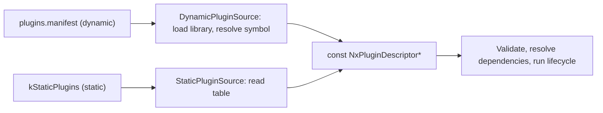
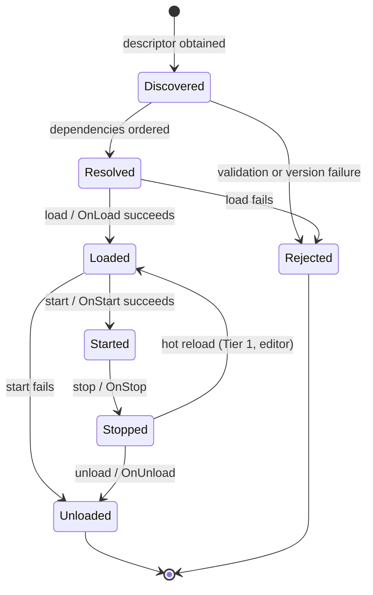
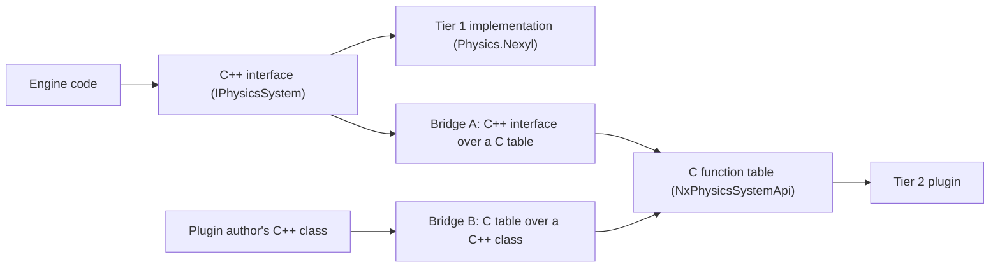

# Nexyl Engine — Plugin ABI

| | |
|---|---|
| Status | Baseline 0.1 — foundation design, pre-implementation |
| Date | 2026-11-13 |
| Audience | Engine developers, plugin and adapter authors |
| Companion documents | [NEXYL_ARCHITECTURE.md](NEXYL_ARCHITECTURE.md), [CODING_STANDARDS.md](CODING_STANDARDS.md) |

The key words MUST, MUST NOT, SHOULD, SHOULD NOT and MAY are used as defined in RFC 2119.

Code blocks in this document are **interface specifications**: declarations only, no implementation.

## Contents

1. [Terms](#1-terms)
2. [The two tiers](#2-the-two-tiers)
3. [Binary conventions](#3-binary-conventions)
4. [Entry point and unified loading](#4-entry-point-and-unified-loading)
5. [Descriptor and host API](#5-descriptor-and-host-api)
6. [Lifecycle](#6-lifecycle)
7. [Interface design patterns](#7-interface-design-patterns)
8. [Bridging C++ and C](#8-bridging-c-and-c)
9. [Core interfaces](#9-core-interfaces)
10. [Versioning and compatibility](#10-versioning-and-compatibility)
11. [Conformance testing](#11-conformance-testing)
12. [Trust model](#12-trust-model)
13. [Checklist for a new or changed interface](#13-checklist-for-a-new-or-changed-interface)

---

## 1. Terms

| Term | Meaning |
|---|---|
| Module | A unit of build with a manifest, as defined in the architecture document. |
| Plugin | A module that `PluginHost` loads at run time, whether it is a dynamic library or statically linked. |
| Host | The `PluginHost` instance of the running process. |
| Interface | A named, versioned set of functions. In C++ it is an abstract class; in C it is a function table. |
| Contract module | A `*.Api` module that defines interfaces, handles and plain-data descriptors. |
| Composition root | The `App` module, the only place that names concrete plugins. |

---

## 2. The two tiers

| | Tier 1 — Engine module | Tier 2 — Stable plugin |
|---|---|---|
| Boundary language | C++: Nexyl types and abstract classes | C: headers in `Abi/include/nexyl/`, valid as C11 and as C++ |
| Typical authors | First-party modules; customer gameplay modules built against the exact engine build | Third-party and marketplace plugins; binary-distributed adapters |
| Toolchain | Same compiler, version and flags as the engine | Any compiler that implements the platform C ABI |
| Compatibility promise | Exact build-fingerprint match, nothing more | Within one ABI major version, a plugin built against minor *m* loads into every host with minor ≥ *m* |
| Allowed across the boundary | Nexyl containers, `Result`, `Ref`, virtual interfaces, templates | Fixed-width scalars, plain structs, opaque handles, function tables |
| Hot reload | Yes, in the editor | Unload and load only, and only if the plugin declares it |
| Call cost | Direct or virtual call | Indirect call through a table; batch-first APIs amortise it |
| On mismatch | Refused at load with a precise error | Refused, or loaded in degraded form if only optional interfaces are missing |

Both tiers share one entry point, one descriptor, one lifecycle and one interface registry. A Tier 1 module is a Tier 2-shaped plugin that additionally offers a C++ fast path guarded by the build fingerprint.

Choosing a tier:

- First-party engine modules are always Tier 1.
- RHI backends are always Tier 1, because of call frequency and platform-SDK coupling.
- An adapter to a third-party engine (PhysX, FMOD, ROS 2) MAY be either. Use Tier 2 when it is distributed as a binary independently of engine releases.

---

## 3. Binary conventions

These rules apply to everything in `Abi/include/nexyl/`.

| Topic | Rule |
|---|---|
| Language | Every header compiles as C11 and as C++, inside `extern "C"`. |
| Calling convention | `NX_CALL` on every function and function pointer. It expands to the platform's default C convention (Microsoft x64, System V AMD64, AAPCS64). |
| Symbol export | `NX_EXPORT`. A Tier 2 plugin exports exactly one symbol. |
| Integers | `uint8_t` … `uint64_t`, `int8_t` … `int64_t` only. No `long`, no `size_t`, no plain `int` in struct fields. Sizes and counts are `uint64_t`. |
| Floating point | `float` (binary32) and `double` (binary64). No `long double`. |
| Boolean | `NxBool32` (`uint32_t`, value 0 or 1). C `bool` is not used. |
| Characters | `char` only as a UTF-8 code unit in text. Never for arithmetic. |
| Strings | `NxStringView { const char* data; uint64_t size; }`. UTF-8, not NUL-terminated. Borrowed for the duration of the call unless stated. |
| Arrays | Pointer plus `uint64_t` count. |
| Enumerations | Declared with `NX_ABI_ENUM`, which gives a fixed 32-bit unsigned underlying type in both languages. Receivers MUST tolerate unknown values. |
| Flags | `uint32_t` or `uint64_t` with `NX_…_BIT` constants. Unknown bits MUST be ignored. |
| Struct layout | Natural alignment. Fields ordered so that no implicit padding exists; any padding is an explicit `reserved` field. No bit-fields. No unions except explicitly tagged ones. |
| Reserved fields | Writers set them to zero. Readers ignore them. |
| Layout checks | Every struct has compile-time size and offset assertions in its header. |
| Byte order | Little-endian. |
| Object handles | Opaque pointer types, for example `typedef struct NxPhysicsWorld_T* NxPhysicsWorld;`. |
| Resource handles | `uint64_t`: 32-bit slot index, 32-bit generation. Zero is the invalid handle. |
| Math types | `NxVec3` (three `float`), `NxVec3d` (three `double`), `NxQuat` (`x y z w`, `float`), `NxPose` (`NxVec3d position; NxQuat rotation;`). Right-handed, Z-up, SI units. |
| Results | `NxResult` (`uint32_t`). `NX_OK` is zero. Non-zero values use the same numbering as the C++ `ErrorCode`: module ID in the high 16 bits, code in the low 16 bits. |
| Outputs on failure | Out-parameters are written only on success. On failure they are left untouched. |
| Exceptions and non-local jumps | MUST NOT cross the boundary. A plugin compiled with exceptions enabled catches everything inside its boundary functions. |
| Memory | Whoever allocates frees. Memory that changes hands is allocated through the host allocator interface. |

Field names in ABI structs are camelCase. Descriptor structs are shared between the C ABI and the C++ contract (section 8), and camelCase keeps them natural in both languages.

Every struct that may grow starts with a common header:

```c
typedef struct NxStructHeader {
    uint32_t    structSize;   /* sizeof the struct as compiled by the writer */
    uint32_t    structType;   /* NX_STRUCT_TYPE_* constant */
    const void* pNext;        /* optional chain of extension structs, or NULL */
} NxStructHeader;
```

---

## 4. Entry point and unified loading

### 4.1 One entry function

Every plugin provides one function that returns its constant descriptor:

```c
typedef const NxPluginDescriptor* (NX_CALL *NxPluginGetDescriptorFn)(void);
```

A plugin declares it with a single macro. The same source builds both ways; the build system selects the linkage.

| Linkage | What `NX_PLUGIN_ENTRY(Physics_Nexyl)` declares | How the host finds it |
|---|---|---|
| Dynamic | Exported symbol `nx_plugin_get_descriptor` | Loads the library named in the plugin manifest and resolves the symbol |
| Static | Non-exported symbol `nx_plugin_get_descriptor_Physics_Nexyl` | Reads a table generated for the application |

### 4.2 The generated static table

For a statically linked application the build system generates one file from the application's plugin list:

```cpp
// StaticPlugins.gen.cpp — generated for the App target; never edited by hand.
extern "C" const NxPluginDescriptor* NX_CALL nx_plugin_get_descriptor_RHI_Metal(void);
extern "C" const NxPluginDescriptor* NX_CALL nx_plugin_get_descriptor_Physics_Nexyl(void);

extern const NxStaticPluginEntry kStaticPlugins[] = {
    { "RHI.Metal",     &nx_plugin_get_descriptor_RHI_Metal },
    { "Physics.Nexyl", &nx_plugin_get_descriptor_Physics_Nexyl },
};
```

The table references every entry function explicitly. This is why static linking is safe:

- The linker cannot discard a plugin, because the application references it.
- Nothing depends on static constructors, so there is no initialization-order problem.
- The plugin order is fixed and identical on every run.

### 4.3 Two sources, one path



After a descriptor is obtained, the host does not know or care how the plugin was linked. Everything in sections 5 to 9 is identical for both.

### 4.4 Platform matrix

| Platform | Default linkage | Library form | Notes |
|---|---|---|---|
| Windows | Dynamic | `.dll` | A monolithic static shipping build is also supported. |
| Linux | Dynamic | `.so` | Same. |
| macOS | Dynamic | `.dylib` | Same. |
| Android | Dynamic | `.so` inside the application package | Libraries load from the package's native library directory only. |
| iOS | Static | — | Downloaded executable code is not permitted. |
| PlayStation 5 | Static | — | Dynamic modules are possible but platform-specific; handled in the private overlay. |
| Xbox Series | Static | — | Same. |

A statically linked host MAY still load dynamic Tier 2 plugins on platforms that permit it.

### 4.5 Rules for dynamic libraries

- Default symbol visibility is hidden. A Tier 2 plugin exports only its entry symbol. A Tier 1 module additionally exports its `NX_<MODULE>_API` symbols.
- Nothing may run at library load or unload: no global constructors or destructors, no library entry-point work. All work happens in lifecycle callbacks.
- Before `unload` returns, the plugin has joined every thread it started and released every host resource.
- A plugin MUST NOT own a private heap for memory that crosses the boundary.

---

## 5. Descriptor and host API

### 5.1 Plugin descriptor

```c
typedef struct NxVersion {
    uint16_t major;
    uint16_t minor;
    uint16_t patch;
    uint16_t reserved;
} NxVersion;

typedef struct NxPluginDependency {
    NxStringView name;
    NxVersion    minVersion;
    uint32_t     flags;            /* NX_PLUGIN_DEPENDENCY_OPTIONAL_BIT */
    uint32_t     reserved;
} NxPluginDependency;

typedef struct NxPluginDescriptor {
    uint32_t     structSize;
    uint32_t     abiVersionMajor;  /* NX_ABI_VERSION_MAJOR the plugin was built against */
    uint32_t     abiVersionMinor;
    uint32_t     tier;             /* NX_PLUGIN_TIER_1 or NX_PLUGIN_TIER_2 */
    NxStringView name;             /* unique; reverse-domain style recommended for third parties */
    NxStringView vendor;
    NxVersion    pluginVersion;
    NxVersion    minEngineVersion;
    uint64_t     buildFingerprint; /* Tier 1: must equal the host's. Tier 2: zero. */
    uint64_t     capabilities;     /* NX_PLUGIN_CAP_*_BIT */
    const NxPluginDependency* dependencies;
    uint64_t     dependencyCount;
    const NxPluginApi*        api; /* lifecycle table, section 5.2 */
    void* (NX_CALL *getCxxPlugin)(void); /* Tier 1: returns Nexyl::IPlugin*. Tier 2: NULL. */
} NxPluginDescriptor;
```

Capability bits:

| Bit | Meaning |
|---|---|
| `NX_PLUGIN_CAP_UNLOADABLE_BIT` | Can be unloaded while the process runs. |
| `NX_PLUGIN_CAP_HOT_RELOAD_BIT` | Supports state save and restore around a reload (Tier 1). |
| `NX_PLUGIN_CAP_DETERMINISTIC_BIT` | Everything it contributes to simulation satisfies the determinism specification. |
| `NX_PLUGIN_CAP_EDITOR_ONLY_BIT` | Must not be loaded by a shipping runtime. |
| `NX_PLUGIN_CAP_HEADLESS_BIT` | Works without a window, GPU or audio device. |

The **build fingerprint** is a 64-bit hash of: exact engine version, compiler identity and version, target triple, language mode, and every build option that can change the layout or behaviour of a type that crosses a Tier 1 boundary. Types visible across Tier 1 boundaries MUST NOT change layout between build configurations unless that configuration switch is part of the fingerprint.

### 5.2 Lifecycle table

```c
typedef struct NxPluginApi {
    uint32_t structSize;
    uint32_t reserved;
    NxResult (NX_CALL *load)(const NxHostApi* host, NxPluginInstance* outInstance);
    NxResult (NX_CALL *start)(NxPluginInstance instance);
    void     (NX_CALL *stop)(NxPluginInstance instance);
    void     (NX_CALL *unload)(NxPluginInstance instance);
} NxPluginApi;
```

### 5.3 Host API

```c
typedef uint64_t NxInterfaceId;    /* hash of the interface name, e.g. "nexyl.physics.system" */

typedef struct NxHostApi {
    uint32_t  structSize;
    uint32_t  abiVersionMinor;     /* the host's minor version */
    NxVersion engineVersion;

    /* Returns the function table of an interface, or NULL if absent or older than minVersion. */
    const void* (NX_CALL *queryInterface)(NxInterfaceId id, uint32_t minVersion, void** outObject);

    /* Publishes an interface implemented by this plugin. */
    NxResult    (NX_CALL *registerInterface)(NxPluginInstance owner, NxInterfaceId id,
                                             uint32_t version, const void* table, void* object);
    void        (NX_CALL *unregisterInterface)(NxPluginInstance owner, NxInterfaceId id);

    /* Details of the most recent failed call on the calling thread. */
    void        (NX_CALL *getLastErrorInfo)(NxErrorInfo* outInfo);
} NxHostApi;
```

Host services are themselves interfaces, obtained through `queryInterface`:

| Interface | Table | Purpose |
|---|---|---|
| `nexyl.host.allocator` | `NxAllocatorApi` | Tagged allocation from host heaps and the plugin's module arena |
| `nexyl.host.log` | `NxLogApi` | Structured logging |
| `nexyl.host.jobs` | `NxJobsApi` | Submitting and waiting on jobs; deterministic parallel-for |
| `nexyl.host.types` | `NxTypeRegistryApi` | Attaching type tables; type lookup |
| `nexyl.host.vfs` | `NxVfsApi` | File access through the virtual file system |

A plugin MUST NOT create threads, heaps or log files of its own where a host service exists, unless its interface contract says otherwise (the audio mixer thread is such an exception).

---

## 6. Lifecycle



| Step | Host action | Plugin obligation |
|---|---|---|
| Discover | Collect descriptors from the dynamic and static sources. | — |
| Validate | Check `structSize`, ABI major, tier, name uniqueness, engine version, and for Tier 1 the build fingerprint. All fields are treated as untrusted input. | Descriptor is constant data. |
| Resolve | Topologically order plugins by declared dependencies; ties are broken by name. A cycle rejects every plugin in it. | Declare every plugin whose interfaces are used. |
| Load | Call `load` in dependency order. | Acquire host interfaces. Register own types and interfaces. Do not call other plugins yet. |
| Start | Call `start` in dependency order, after every plugin has loaded. | Dependencies are started; their interfaces may now be used. |
| Stop | Call `stop` in reverse order. | Stop producing work. Finish or cancel outstanding jobs. |
| Unload | Call `unload` in reverse order; then verify the module arena is empty, detach type tables, and close the library. | Unregister interfaces. Release everything. |

Rules:

- All lifecycle callbacks run on the main thread and never concurrently.
- A plugin that fails to load is unloaded; its dependents are rejected. If the plugin or a dependent is required by the application, startup fails with a report naming the chain. Optional plugins are logged and skipped.
- Because the order is a pure function of the plugin set, startup is reproducible.
- Hot reload follows the sequence in the architecture document (section 8.13). It is available only to Tier 1 plugins that set `NX_PLUGIN_CAP_HOT_RELOAD_BIT`.

---

## 7. Interface design patterns

Every interface, in either tier, follows these patterns.

| ID | Pattern | Rule |
|---|---|---|
| P1 | Sized function tables | A C table starts with `structSize`. Functions are only ever appended. A caller checks that `structSize` covers a member before calling a function newer than its minimum version. |
| P2 | Extensible structs | Descriptors that may grow start with `NxStructHeader`. New fields are appended; unrelated extensions chain through `pNext`. Unknown chained structs are skipped. |
| P3 | Two kinds of handle | System objects are opaque pointers. Pooled resources are 64-bit generation-checked handles; a stale handle is detected, never dereferenced. |
| P4 | Batch first | Any operation that is naturally applied to many elements takes spans. Per-element convenience calls are wrappers on the caller's side. |
| P5 | Caller-provided output | Outputs go into caller-supplied spans. Enumerations use the two-call form: query the count, then fill. The callee does not allocate memory the caller must free. |
| P6 | Stated ownership | Every pointer parameter is documented as borrowed (call duration), retained (until a named event) or transferred (with its allocator). |
| P7 | Pull, not push | Results and events are returned in buffers that the caller reads at a defined point. An implementation does not call back into the engine from its own threads. |
| P8 | Injected services | Allocator, job scheduler and log are passed in at creation. Implementations do not create their own unless the contract allows it. |
| P9 | Capabilities, not version sniffing | Optional features are reported in a capabilities struct. Callers branch on capabilities. |
| P10 | Documented execution class | Every function states its thread class (`main`, `any`, `job`, `stage`, `realtime`) and its determinism class (`deterministic`, `presentation`). |
| P11 | Uniform errors | Fallible functions return `Result<T, Error>` in C++ and `NxResult` in C, with identical codes. |
| P12 | Deterministic ordering | Any returned collection that can influence simulation is sorted by a documented stable key. |

Interface lifetime in C++: interfaces have a protected, non-virtual destructor. Objects are released by the system that created them (`DestroyX`), by handle, or by intrusive reference count. An interface pointer is never passed to `delete`.

---

## 8. Bridging C++ and C

Engine code always programs against the C++ interface. Tier 2 exists at the edge.



| Element | Definition |
|---|---|
| Shared plain data | Descriptor, state and event structs are defined **once**, in the C headers. The C++ contract module uses the same types under namespace aliases (for example `Nexyl::Physics::BodyDesc` is `NxBodyDesc`). There is no second definition to drift. |
| Bridge A | An engine-side class that implements the C++ interface by calling a Tier 2 function table. It converts `NxResult` to `Result`, spans to pointer-count pairs, and validates `structSize` before optional calls. |
| Bridge B | A header-only SDK helper that produces a C function table from a C++ class. A concept verifies at compile time that the class provides every required operation. Plugin authors can therefore write C++ and still export pure C. |
| Generation | Both bridges are mechanical. They are generated by the header tool from the contract module and are not written by hand. |

Consequences:

- A Tier 1 implementation and a Tier 2 implementation of the same contract are interchangeable at run time.
- The cost of Tier 2 is one extra indirect call per interface call, which batch-first design (P4) keeps negligible.

---

## 9. Core interfaces

Each subsection gives the role, the C++ contract, the execution rules and an adapter mapping. The C tables mirror the C++ interfaces one function to one function; the physics table is shown as the worked example.

### 9.1 IPlugin

The Tier 1 lifecycle object. One instance per loaded module.

```cpp
namespace Nexyl {

/// Services the host hands to a Tier 1 plugin. All pointers are borrowed and outlive the plugin.
struct PluginContext {
    IAllocator*               moduleAllocator;   ///< Module-lifetime arena.
    Reflection::TypeRegistry* typeRegistry;
    IInterfaceRegistry*       interfaces;
    Jobs::IJobScheduler*      jobs;
    const EngineInfo*         engine;
};

class IPlugin {
public:
    virtual const PluginInfo& GetInfo() const = 0;

    /// Register types, interfaces and factories. Do not call other plugins.
    virtual Result<void, Error> OnLoad(const PluginContext& context) = 0;
    /// All dependencies are started. Begin work.
    virtual Result<void, Error> OnStart() = 0;
    /// Stop producing work; finish or cancel outstanding jobs.
    virtual void OnStop() = 0;
    /// Unregister everything; leave the module arena empty.
    virtual void OnUnload() = 0;

    /// Hot reload: persist state that reflection cannot reach.
    virtual Result<void, Error> OnSaveReloadState(IByteWriter& writer) = 0;
    virtual Result<void, Error> OnRestoreReloadState(IByteReader& reader) = 0;

protected:
    ~IPlugin() = default;
};

} // namespace Nexyl
```

| Rule | Detail |
|---|---|
| Thread class | `main` for every method. |
| Registration | Interfaces are published through `IInterfaceRegistry`, keyed by interface ID and version. This is the same registry Tier 2 plugins reach through `registerInterface`. |
| Type tables | The generated type-table attach function is called in `OnLoad` and its counterpart in `OnUnload`. |
| Reload state | Reflected objects are saved and restored by the host. The two reload methods cover only non-reflected state; most plugins leave them empty. |

### 9.2 IPhysicsSystem and IPhysicsWorld

`IPhysicsSystem` is the backend: a factory for worlds and shared immutable data. `IPhysicsWorld` is one simulated world.

```cpp
namespace Nexyl::Physics {

class IPhysicsSystem {
public:
    virtual const PhysicsCapabilities& GetCapabilities() const = 0;

    virtual Result<IPhysicsWorld*, Error> CreateWorld(const PhysicsWorldDesc& desc) = 0;
    virtual void DestroyWorld(IPhysicsWorld* world) = 0;

    virtual Result<ShapeHandle, Error> CreateShape(const ShapeDesc& desc) = 0;
    virtual void DestroyShape(ShapeHandle shape) = 0;
    virtual Result<MaterialHandle, Error> CreateMaterial(const PhysicsMaterialDesc& desc) = 0;
    virtual void DestroyMaterial(MaterialHandle material) = 0;

protected:
    ~IPhysicsSystem() = default;
};

class IPhysicsWorld {
public:
    // Structure — between steps only.
    virtual Result<void, Error> CreateBodies(Span<const BodyDesc> descs, Span<BodyHandle> outBodies) = 0;
    virtual void DestroyBodies(Span<const BodyHandle> bodies) = 0;
    virtual Result<ConstraintHandle, Error> CreateConstraint(const ConstraintDesc& desc) = 0;
    virtual void DestroyConstraint(ConstraintHandle constraint) = 0;
    virtual Result<ArticulationHandle, Error> CreateArticulation(const ArticulationDesc& desc) = 0;
    virtual void DestroyArticulation(ArticulationHandle articulation) = 0;

    // Inputs — between steps only, batched.
    virtual void SetBodyPoses(Span<const BodyHandle> bodies, Span<const WorldPose> poses) = 0;
    virtual void SetKinematicTargets(Span<const BodyHandle> bodies, Span<const WorldPose> targets) = 0;
    virtual void ApplyForces(Span<const BodyForce> forces) = 0;
    virtual void SetJointTargets(ArticulationHandle articulation, Span<const JointTarget> targets) = 0;

    // Step — exactly one fixed tick.
    virtual Result<void, Error> Step(const PhysicsStepDesc& step) = 0;

    // Outputs — valid until the next Step.
    virtual Span<const BodyState> GetMovedBodies() const = 0;
    virtual Span<const ContactEvent> GetContactEvents() const = 0;
    virtual Result<void, Error> GetJointStates(ArticulationHandle articulation, Span<JointState> outStates) const = 0;

    // Queries — between steps; concurrent readers allowed.
    virtual void RayCast(Span<const RayCastQuery> queries, Span<RayCastHit> outHits) const = 0;
    virtual void ShapeCast(Span<const ShapeCastQuery> queries, Span<ShapeCastHit> outHits) const = 0;
    virtual Result<usize, Error> Overlap(const OverlapQuery& query, Span<BodyHandle> outBodies) const = 0;

    // Determinism and state.
    virtual u64 ComputeStateHash() const = 0;
    virtual Result<void, Error> SaveState(IByteWriter& writer) const = 0;
    virtual Result<void, Error> RestoreState(IByteReader& reader) = 0;

    // Diagnostics.
    virtual void DebugDraw(IDebugDrawSink& sink, const DebugDrawDesc& desc) const = 0;
    virtual void GetStats(PhysicsWorldStats& outStats) const = 0;

protected:
    ~IPhysicsWorld() = default;
};

} // namespace Nexyl::Physics
```

Excerpt of the corresponding C table:

```c
typedef struct NxPhysicsWorldApi {
    uint32_t structSize;
    uint32_t version;             /* NX_PHYSICS_WORLD_API_VERSION */

    NxResult (NX_CALL *createBodies)(NxPhysicsWorld world, const NxBodyDesc* descs,
                                     uint64_t count, NxBodyHandle* outBodies);
    void     (NX_CALL *destroyBodies)(NxPhysicsWorld world, const NxBodyHandle* bodies, uint64_t count);
    NxResult (NX_CALL *step)(NxPhysicsWorld world, const NxPhysicsStepDesc* step);
    void     (NX_CALL *getMovedBodies)(NxPhysicsWorld world, const NxBodyState** outStates, uint64_t* outCount);
    uint64_t (NX_CALL *computeStateHash)(NxPhysicsWorld world);
    /* ... one entry per IPhysicsWorld method, in declaration order ... */
} NxPhysicsWorldApi;
```

Contract:

| Topic | Rule |
|---|---|
| Thread class | Structure, inputs and `Step` are `stage`: called only from the `Physics` simulation stage, by one thread. Queries are `job` between steps. |
| Parallelism | `Step` fans out only through the job scheduler supplied in `PhysicsSystemDesc`. The implementation creates no threads. |
| Memory | All allocation goes through the allocator supplied in `PhysicsSystemDesc`. |
| Units and frames | SI units; right-handed, Z-up. Positions are f64 (`WorldPose`), everything else f32. An adapter converts for its engine. |
| Output order | `GetMovedBodies` is sorted by body handle index. `GetContactEvents` is sorted by (first body, second body, feature ID). |
| Events | Contacts and triggers are pulled after `Step`. No callback runs during the step. |
| Stale handles | Ignored, reported as an error in development builds. |
| Determinism | If `PhysicsCapabilities.deterministicCrossPlatform` is set, the implementation satisfies the determinism specification, and `ComputeStateHash` covers every bit of state that can influence a future step. |
| Snapshots | `RestoreState` after `SaveState` yields a world whose subsequent hashes are identical to the original's. |
| Non-deterministic adapters | Allowed. The engine then disables strict replay validation and says so in the scenario report. |

`PhysicsCapabilities` reports at least: cross-platform determinism, state snapshots, articulations, continuous collision detection, soft bodies, f64 position support, and capacity limits.

Adapter mapping example (PhysX):

| Nexyl contract | PhysX concept | Adapter note |
|---|---|---|
| Injected allocator | Allocator callback | Routes into the `ThirdParty` memory tag. |
| Injected job scheduler | CPU dispatcher | PhysX tasks become Nexyl jobs; no PhysX worker threads. |
| `IPhysicsWorld` | Scene | Gravity and tolerances configured for metres and Z-up. |
| Bodies, shapes, materials | Rigid actors, shapes, materials | Handle pool maps handles to actor pointers. |
| Articulations | Reduced-coordinate articulations | Joint targets map to drive targets. |
| `GetMovedBodies` | Active-actor list | Sorted by handle index in the adapter. |
| `GetContactEvents` | Simulation event callback | Buffered during the step, sorted afterwards. |
| Determinism capability | Same-platform determinism only | Reported as **not** cross-platform deterministic. |

### 9.3 IAudioSystem

One audio backend: output device, mixing graph, voices, spatial state and authored events.

```cpp
namespace Nexyl::Audio {

class IAudioSystem {
public:
    virtual const AudioCapabilities& GetCapabilities() const = 0;

    // Output device.
    virtual Result<usize, Error> EnumerateOutputDevices(Span<AudioDeviceInfo> outDevices) const = 0;
    virtual Result<void, Error> OpenOutput(const AudioOutputDesc& desc) = 0;
    virtual void CloseOutput() = 0;

    // Sound data.
    virtual Result<SoundHandle, Error> CreateSound(const SoundDesc& desc) = 0;
    virtual void DestroySound(SoundHandle sound) = 0;

    // Mixing graph.
    virtual Result<BusHandle, Error> CreateBus(const BusDesc& desc) = 0;
    virtual void DestroyBus(BusHandle bus) = 0;
    virtual void SetBusParams(Span<const BusParam> params) = 0;

    // Voices.
    virtual Result<VoiceHandle, Error> Play(const PlayDesc& desc) = 0;
    virtual void Stop(VoiceHandle voice, f32 fadeOutSeconds) = 0;
    virtual void SetVoiceParams(Span<const VoiceParam> params) = 0;

    // Spatial state.
    virtual void SetListeners(Span<const ListenerState> listeners) = 0;
    virtual void SetEmitters(Span<const EmitterState> emitters) = 0;

    // Authored events (middleware style).
    virtual Result<BankHandle, Error> LoadBank(const SoundBankDesc& desc) = 0;
    virtual void UnloadBank(BankHandle bank) = 0;
    virtual Result<EventInstanceHandle, Error> PostEvent(const AudioEventDesc& desc) = 0;

    // Frame.
    virtual void Update(const AudioUpdateDesc& update) = 0;
    virtual void GetStats(AudioStats& outStats) const = 0;

protected:
    ~IAudioSystem() = default;
};

} // namespace Nexyl::Audio
```

Contract:

| Topic | Rule |
|---|---|
| Thread class | Every method is `main` (presentation phase). Methods are non-blocking: they enqueue commands. |
| Real-time thread | The implementation owns the mix thread or device callback. That thread never allocates, never locks, and never calls engine code. This is the documented exception to pattern P8. |
| Command flush | `Update` is called once per presentation frame and publishes queued commands to the mix thread through a lock-free queue. |
| Sound data | `SoundDesc` supplies either borrowed sample memory, retained until `DestroySound` has taken effect, or a stream source that the implementation pulls from a non-real-time thread. |
| Positions | Listener and emitter positions are f64 world positions. The implementation converts to listener-relative f32. |
| Voice limits | When voices exceed capacity the implementation virtualises by priority; a virtual voice keeps its handle. |
| Determinism | `presentation`. Audio output is not deterministic. The tick and order in which simulation posts events is deterministic, and that is what replay reproduces. |

`AudioCapabilities` reports at least: voice capacity, supported sample rates and channel layouts, spatialisation methods, and whether authored events and banks are supported. The first-party `Audio.Nexyl` implements voices and buses; `LoadBank` and `PostEvent` return an unsupported error until authored events exist.

Adapter mapping example (FMOD):

| Nexyl contract | FMOD concept | Adapter note |
|---|---|---|
| Injected allocator | Memory callbacks | Installed before system creation. |
| `LoadBank`, `PostEvent` | Studio banks, event descriptions and instances | Event parameters map from `AudioEventDesc`. |
| `Play`, voices | Core sounds and channels | For content not authored as events. |
| Buses | Channel groups / studio buses | |
| `SetListeners`, `SetEmitters` | 3D listener and event attributes | Adapter remaps Z-up right-handed to the middleware's convention. |
| `Update` | System update | Called exactly once per frame. |
| Real-time thread | Middleware mixer thread | Owned by the middleware. |

### 9.4 IRHIDevice

One logical GPU device. Backends are Tier 1 modules. A C table (`NxRhiDeviceApi`) exposes the device to Tier 2 plugins as **consumers**, for example to create a texture they fill, or to obtain native handles for interop.

```cpp
namespace Nexyl::RHI {

class IRHIDevice {
public:
    virtual const DeviceCapabilities& GetCapabilities() const = 0;

    // Resources — callable from jobs.
    virtual Result<BufferHandle, Error> CreateBuffer(const BufferDesc& desc) = 0;
    virtual Result<TextureHandle, Error> CreateTexture(const TextureDesc& desc) = 0;
    virtual Result<TextureViewHandle, Error> CreateTextureView(const TextureViewDesc& desc) = 0;
    virtual Result<SamplerHandle, Error> CreateSampler(const SamplerDesc& desc) = 0;
    virtual Result<ShaderHandle, Error> CreateShader(const ShaderDesc& desc) = 0;
    virtual Result<PipelineHandle, Error> CreatePipeline(const PipelineDesc& desc) = 0;
    virtual Result<BindSetHandle, Error> CreateBindSet(const BindSetDesc& desc) = 0;
    virtual void Destroy(ResourceHandle resource) = 0;
    virtual PipelineStatus GetPipelineStatus(PipelineHandle pipeline) const = 0;

    // Bindless devices only.
    virtual BindlessIndex GetBindlessIndex(ResourceHandle resource) const = 0;

    // Data transfer.
    virtual Result<void, Error> WriteBuffer(BufferHandle buffer, u64 offset, Span<const u8> data) = 0;
    virtual Result<void, Error> WriteTexture(TextureHandle texture, const TextureRegion& region, Span<const u8> data) = 0;
    virtual Result<ReadbackHandle, Error> RequestReadback(const ReadbackDesc& desc) = 0;

    // Presentation.
    virtual Result<SwapchainHandle, Error> CreateSwapchain(const SwapchainDesc& desc) = 0;
    virtual Result<void, Error> ResizeSwapchain(SwapchainHandle swapchain, u32 width, u32 height) = 0;

    // Frame.
    virtual Result<FrameContext, Error> BeginFrame() = 0;
    virtual ICommandList* AcquireCommandList(const FrameContext& frame, QueueType queue) = 0;
    virtual Result<void, Error> Submit(const FrameContext& frame, Span<ICommandList* const> commandLists) = 0;
    virtual Result<void, Error> EndFrame(const FrameContext& frame, Span<const SwapchainHandle> present) = 0;

    // Maintenance.
    virtual void WaitIdle() = 0;
    virtual void GetMemoryStats(DeviceMemoryStats& outStats) const = 0;
    virtual NativeHandle GetNativeHandle(NativeObject object) const = 0;

protected:
    ~IRHIDevice() = default;
};

class ICommandList {
public:
    virtual void BeginRenderPass(const RenderPassDesc& desc) = 0;
    virtual void EndRenderPass() = 0;
    virtual void SetPipeline(PipelineHandle pipeline) = 0;
    virtual void SetBindSet(u32 slot, BindSetHandle bindSet) = 0;
    virtual void SetConstants(Span<const u8> data) = 0;
    virtual void SetVertexBuffers(u32 firstSlot, Span<const VertexBufferBinding> buffers) = 0;
    virtual void SetIndexBuffer(const IndexBufferBinding& buffer) = 0;
    virtual void Draw(const DrawDesc& draw) = 0;
    virtual void DrawIndirect(const IndirectDrawDesc& draw) = 0;
    virtual void Dispatch(const DispatchDesc& dispatch) = 0;
    virtual void Transition(Span<const ResourceTransition> transitions) = 0;
    virtual void CopyBuffer(const BufferCopyDesc& copy) = 0;
    virtual void CopyTexture(const TextureCopyDesc& copy) = 0;
    virtual void BeginDebugGroup(StringView name) = 0;
    virtual void EndDebugGroup() = 0;

protected:
    ~ICommandList() = default;
};

} // namespace Nexyl::RHI
```

Contract:

| Topic | Rule |
|---|---|
| Capability tier | `DeviceCapabilities.tier` is `Bindless` or `Compat`, fixed at device creation. Limits (heap capacities, maximum sizes), formats and optional features are reported in the same struct. |
| Handles | 64-bit, generation-checked. Typed handles convert to `ResourceHandle`, which also carries the resource class. |
| Bindless index | On a `Bindless` device the slot index of a view or sampler is its shader-visible index and is stable for the resource's lifetime. `GetBindlessIndex` is invalid on a `Compat` device. |
| `BindSet` | The fixed-slot binding path. Available on every device, required on `Compat`. |
| Destruction | `Destroy` invalidates the handle at once and defers the GPU release until every frame that could reference the resource has retired. |
| Thread class | Resource creation and destruction: `job`. A command list: used by one job at a time. `BeginFrame`, `Submit`, `EndFrame`: the RHI submit thread. |
| Submission order | `Submit` executes command lists in span order. Completion order of recording jobs is irrelevant. |
| Pipelines | `CreatePipeline` returns immediately; compilation is asynchronous. `GetPipelineStatus` reports progress. Drawing with an unfinished pipeline is skipped, not stalled. |
| Resource states | Transitions are explicit at this level. The render graph above generates them. |
| Exhaustion | Out of descriptors or device memory is an `Error`, never a crash. |
| Device loss | Returned as an `Error` from frame functions and raised as an event. The device is recreated by the renderer from retained descriptions. |
| Determinism | `presentation`. |

Backend mapping:

| Nexyl contract | Vulkan | DX12 | Metal | OpenGL (Compat) |
|---|---|---|---|---|
| Bindless heap | Global descriptor set, one large array per resource class, update-after-bind | Shader-visible descriptor heaps, direct heap indexing | Resource IDs in argument buffers | Not available |
| `BindSet` | Descriptor set | Descriptor table | Argument buffer | Texture and buffer binding points |
| `ICommandList` | Command buffer | Command list | Command buffer and encoders | Recorded command stream replayed on the context thread |
| `Transition` | Pipeline barriers | Resource barriers | Mostly implicit | Implicit |
| Shader input | SPIR-V | DXIL | Metal library | GLSL / ESSL text |

### 9.5 Other contracts

`IScriptRuntime` (`Script.Api`) and the connector interfaces in `Sim.Core` follow the same patterns and will be specified in this document when their modules enter the roadmap.

---

## 10. Versioning and compatibility

### 10.1 Version numbers

| Number | Scope | Changes when |
|---|---|---|
| `NX_ABI_VERSION_MAJOR` | Plugin protocol: descriptor, lifecycle table, host API, binary conventions | A breaking change to any of them |
| `NX_ABI_VERSION_MINOR` | Same scope | A compatible addition |
| Interface version | One interface | A compatible addition to that interface |
| Interface ID | One interface | A breaking change: the interface gets a new name and ID |
| Build fingerprint | Tier 1 | Any engine rebuild that could alter C++ layout or behaviour |

### 10.2 What a minor version may do

| Allowed (compatible) | Forbidden without a new interface ID or major version |
|---|---|
| Append a function to a table | Remove, reorder or change the signature of a function |
| Append a field to a struct that starts with `structSize` | Change the size, offset, type or meaning of an existing field |
| Add an enumeration value or flag bit | Reuse or renumber a value |
| Add a `pNext` extension struct | Make an extension mandatory |
| Add an interface | Change the encoding of a handle |
| Relax a precondition | Tighten a precondition, or change threading, ownership or ordering rules |

### 10.3 Compatibility matrix (Tier 2)

| Plugin built against | Host provides | Result |
|---|---|---|
| Major *M*, minor *m* | Major *M*, minor ≥ *m* | Loads. Plugin sees at least the interfaces it was built for. |
| Major *M*, minor *m* | Major *M*, minor < *m* | Loads only if every interface it requires at its `minVersion` exists; otherwise rejected with the missing interface named. |
| Major *M* | Major ≠ *M* | Rejected. |

### 10.4 Deprecation

A replaced interface ID remains available, implemented on top of its successor where possible, for at least one full major engine version. Deprecations are listed in release notes and reported at load time in development builds.

### 10.5 Tier 1

Tier 1 has no compatibility window. A Tier 1 module is rebuilt with every engine build, and the fingerprint check turns any mismatch into a clear load error instead of undefined behaviour.

---

## 11. Conformance testing

| Test | Purpose |
|---|---|
| Layout assertions | Compile-time size and offset checks in every ABI header. |
| Golden layout dump | CI records sizes, offsets and table member order per platform and compares with the committed baseline. Any difference requires a version decision. |
| Dual-language compile | Every ABI header is compiled as C11 and as C++ by each supported compiler. |
| Cross-compiler plugin | A fixture plugin built with a different compiler than the host is loaded and exercised. |
| Frozen fixtures | Plugin binaries built against earlier minor versions are kept and loaded by every new host. |
| Negotiation fuzzing | Descriptors and tables with random sizes, versions and null entries must be rejected cleanly. |
| Static and dynamic parity | The same plugin set built both ways must produce the same registry contents and the same lifecycle order. |
| Bridge round trip | A contract implemented in C++, exported through bridge B, consumed through bridge A, must behave identically to the direct C++ path, including determinism hashes for physics. |

---

## 12. Trust model

Plugins are native code and run with the full privileges of the process. The ABI provides compatibility, not isolation.

- The host validates descriptors and tables defensively, because a malformed plugin should produce a diagnostic, not a crash.
- Applications MAY require plugins to be signed and MAY restrict the directories from which dynamic plugins load. The editor warns when loading an unsigned plugin.
- Untrusted logic belongs in a script runtime, not in a native plugin.

---

## 13. Checklist for a new or changed interface

1. Does the contract belong in an existing `*.Api` module? Adding a contract module changes the module table in the architecture document.
2. Define plain-data structs once, in the C header, with `NxStructHeader` where growth is expected, and with layout assertions.
3. Write the C++ interface: batch-first, handles not pointers, `Result` for fallible calls, protected non-virtual destructor.
4. For every function, document thread class, determinism class, ownership of each pointer, and ordering of each returned collection.
5. Add a capabilities field for every optional feature.
6. Let the header tool generate the C table and both bridges. Do not hand-write them.
7. Decide the version impact using section 10.2. A forbidden change means a new interface ID.
8. Update the golden layout baseline in the same change, with the version decision stated.
9. Add or extend conformance tests (section 11), including a bridge round trip.
10. If simulation can observe the interface, add a scenario to the determinism suite.
